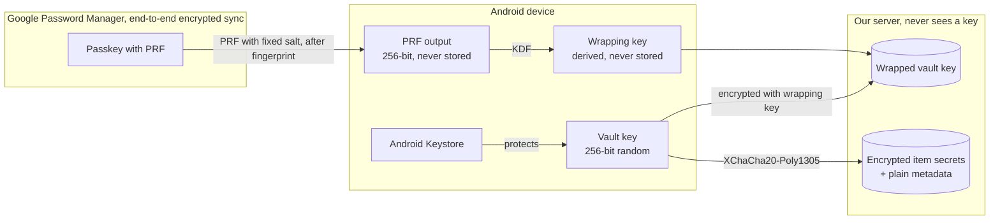
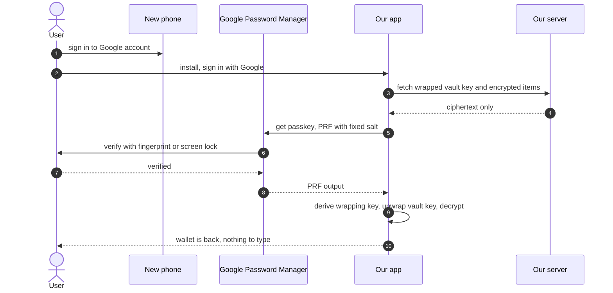

# ‏`ADR-001`: ניהול מפתחות והצפנה בצד הלקוח

- **סטטוס:** מקובל, גרסה 4 (2026-10-23). מנגנון השחזור אומת בניסוי הטכני 01.
- **מה השתנה בגרסה 4:**
  - העטיפה הראשית של מפתח הכספת היא עכשיו `passkey` עם הרחבת `PRF`, ולא מפתח שחזור ב־`Block Store` (החלטה 034).
  - ‏`Block Store` עבר לחלופות, ולא נבנה עכשיו.
  - מוצע `KDF` אחר, כי הקלט הוא עכשיו 256 ביט.
- **מה השתנה בגרסה 3:** נוספה הוכחה שהמכשיר מחזיק את הכספת (החלטה 033), ו־`passkey` נוסף כמועמד ראשון בניסוי הטכני.
- **החלטות קשורות:** 003, 006, 008, 012, 018, 028, 029, 033, 034.
- **דרישות קשורות:** `AUTH-2` עד `AUTH-6`, `BAK-1`, `BAK-3`, `SEC-1`.
- **מה השתנה בגרסה 2:**
  - קוד השחזור כבר לא מוצג למשתמש. מפתח השחזור נשמר אוטומטית בגיבוי המוצפן של `Google`, דרך `Block Store`.
  - הנעילה היא ברמת הממשק.
  - הייצוא המוצפן הוסר.
  - הסיבה: המשתמש לא צריך לזכור שום דבר חדש (החלטות 028 ו־029).

## ההחלטה בקצרה

- **מפתח כספת אקראי** מצפין במכשיר את כל הסודות.
- **בשרת** נשמר עותק של מפתח הכספת, עטוף במפתח שנגזר מפלט `PRF` של `passkey`.
- **ה־`passkey`** נשמר במנהל הסיסמאות של `Google`, ומסתנכרן מוצפן מקצה לקצה לכל טלפון שמחובר לאותו חשבון.
- **המשתמש לא צריך לזכור כלום.** בטלפון חדש מתחברים לחשבון `Google` ומאשרים בטביעת אצבע או בנעילת המסך.
- **השרת שלנו** לא רואה לעולם אף מפתח.

## ההקשר

**מה מגינים עליו:** הסודות שמוגדרים בהחלטות 003 ו־006, כלומר פרטי המימוש וכל הטקסט החופשי.

**האיומים:**
- פריצה לשרת.
- אדמין או מפעיל.
- השתלטות על חשבון ה־`Google` של המשתמש.
- שרת פרוץ שמחליף נתונים מוצפנים בין פריטים.
- טלפון נעול שנגנב.
- דליפה דרך לוגים.

**הדרישות:**
- שחזור במכשיר חדש, **בלי שהמשתמש יזכור או ישמור שום דבר**.
- מימוש בלי חיבור לרשת.
- הרחבה בעתיד לשיתוף ולארנק משפחתי.

**האילוצים:**
- `React Native` עם `Expo` (החלטה 022).
- קודם `Android`, ובהמשך `iOS` (החלטה 004).
- לא כותבים פרימיטיבים קריפטוגרפיים בעצמנו (החלטה 008).

## האפשרויות שנשקלו לשחזור

- **מפתח שמוחזק בשרת, בשירות ניהול מפתחות כמו `KMS`:**
  - הכי פשוט למשתמש.
  - אבל השרת יכול לפענח את הקודים, וזה סותר את החלטה 003 ואת המטרה של מינימום אחריות. **נפסלה.**
- **סיסמת־על:** עוד סיסמה לזכור, ושכחה שלה פירושה אובדן מידע. **נפסלה.**
- **קוד שחזור שהמשתמש שומר:** בטוח, אבל מעביר את האחריות למשתמש. זו הייתה גרסה 1 של המסמך. **נדחתה לבקשת המשתמש.**
- **מפתח שחזור ב־`Block Store`, הגיבוי המוצפן של `Android`:**
  - המשתמש לא רואה ולא שומר שום דבר.
  - הגיבוי של `Google` מוצפן מקצה לקצה, ונפתח בקוד הנעילה של הטלפון הישן (לאימות).
  - דורש מודול `Kotlin`, ונשען על שחזור של כל הטלפון מגיבוי.
  - **נבחרה בגרסה 2. בגרסה 4 עברה לחלופה,** ולא נבנית עכשיו.
- **`passkey` עם הרחבת `PRF`:**
  - גם היא לא דורשת לזכור כלום.
  - בטלפון חדש מספיק להתחבר לחשבון `Google`. לא צריך לשחזר את כל הטלפון.
  - עובדת ב־`Expo` דרך `react-native-passkeys`, בלי מודול `Kotlin` (עובדה, נבדק בניסוי 01).
  - **נבחרה בגרסה 4** (החלטה 034).

## ההחלטה

### היררכיית המפתחות

- **מפתח הכספת (`vault key`):** 256 ביט אקראיים, שנוצרים במכשיר. הוא מצפין את כל הסודות.
- **ה־`passkey`:**
  - נוצר במנהל הסיסמאות של `Google`, עם הרחבת `PRF`.
  - הוא `discoverable`, ולכן אפשר למצוא אותו בטלפון חדש בלי לדעת מראש את המזהה שלו.
  - ה־`RP ID` שלו הוא הדומיין של המוצר. בניסוי זה היה `danielshapi4a.github.io`, והדומיין למוצר עוד לא נבחר (שאלה פתוחה).
- **פלט ה־`PRF`:** 256 ביט, שה־`passkey` מחשב מ־`salt` קבוע. הוא זהה בכל טלפון ובכל התקנה, ואף פעם לא נשמר.
- **ה־`salt`:** קבוע, עם מספר גרסה, למשל `coupon-wallet-prf-v1`. הוא לא סוד.
- **מפתח העטיפה (`wrapping key`):** נגזר מפלט ה־`PRF`, ואף פעם לא נשמר.
- **מפתח הכספת העטוף:** מפתח הכספת, מוצפן במפתח העטיפה ונשמר בשרת שלנו.

### איזה `KDF`

- **לא `Argon2id`:** ‏`Argon2id` איטי בכוונה, כדי להקשות על ניחוש של סיסמה חלשה. פלט ה־`PRF` הוא 256 ביט שאי אפשר לנחש, ולכן `KDF` מהיר מספיק. **את ה־`KDF` בוחרים לפי האנטרופיה של הקלט.**
- **מוצע: `crypto_kdf_derive_from_key` של `libsodium`, ולא `HKDF-SHA256`:**
  - **הבעיה:** ב־`react-native-libsodium`, ‏`HKDF-SHA256` זמין רק בפונקציות שמתחילות ב־`_unstable` (עובדה, נמצא בניסוי 01).
  - **למה זה אפשרי עכשיו:** ‏`crypto_kdf` דורש קלט של 256 ביט. מפתח השחזור בגרסה 3 היה 128 ביט, ופלט ה־`PRF` הוא 256 ביט.
  - **מה כבר נבדק:** ‏`crypto_kdf` עבד בניסוי, בגזירת מפתח החתימה ממפתח הכספת.
  - **המחיר:** ‏`crypto_kdf` מבוסס על `BLAKE2b`, והוא פחות נפוץ מ־`HKDF` מחוץ ל־`libsodium`. אם צריך לגזור את המפתח בפלטפורמה אחרת, צריך `libsodium` גם שם (הנחה).

### ההצפנה

- **אלגוריתם:** `XChaCha20-Poly1305` (`AEAD`) מתוך `libsodium`, עם `nonce` אקראי של 192 ביט לכל הצפנה.
- **`AAD`:** מזהה הפריט, שם השדה וגרסת הפורמט. כך שרת פרוץ לא יכול להעביר קוד מוצפן מפריט אחד לאחר.
- **פורמט:** גרסה, `nonce`, ואחריהם ה־`ciphertext` יחד עם תג האימות (החלטה 008).
- **ספרייה ל־`React Native`:** ‏`react-native-libsodium`. היא עובדת ב־`Expo` על `Android`, כולל דחייה של `AAD` שגוי ושל `ciphertext` ששונה (עובדה, נבדק בניסוי 01).

### שמירה במכשיר ונעילה

- **מפתח הכספת:** נשמר ב־`expo-secure-store`, שנשען על `Android Keystore`. הוא נמחק כשמסירים את האפליקציה (עובדה, נבדק בניסוי 01). לכן השחזור נשען על ה־`passkey`.
- **בזיכרון:** המפתח נמצא בזיכרון רק כשהאפליקציה פתוחה.
- **נעילה ברמת הממשק (החלטה 028):** האפליקציה מבקשת אימות ביומטרי או את קוד הנעילה של המכשיר לפני שהיא נפתחת. המפתח עצמו לא קשור לאימות ברמת החומרה.
- **מכשיר בלי נעילה בקוד** (החלטות 028 ו־029):
  - **נעילה:** האפליקציה מבקשת קוד אפליקציה של 4 ספרות.
  - **הקוד לא משמש להצפנה.** יש לו רק 10,000 אפשרויות, ולכן כל מחשב יכול לנחש אותו מיד אם יקבל את המידע המוצפן. נעילת ממשק מגבילה את מספר הניסיונות, ומפתח הצפנה לא יכול להגביל אותם.
  - **שחזור:** בלי נעילת מסך כנראה אי אפשר ליצור `passkey` (לאימות). במצב הזה אין שחזור אוטומטי, וזה תלוי בשאלה הפתוחה על עטיפה שנייה.

### התהליכים

- **הגדרה ראשונה:**
  - נוצר מפתח כספת.
  - נוצר `passkey` עם `PRF`, והמשתמש מאשר בטביעת אצבע או בנעילת המסך.
  - מחושב פלט `PRF`, נגזר ממנו מפתח העטיפה, ומפתח הכספת העטוף נשלח לשרת.
  - המשתמש לא מזין ולא שומר שום דבר.
  - בניסוי היו שני אישורים, אחד ליצירה ואחד לחישוב. אם אפשר לחשב את ה־`PRF` כבר ביצירה, יספיק אישור אחד (לאימות).
- **בדיקת השחזור:**
  - אם אי אפשר ליצור `passkey`, למשל כי אין חשבון `Google` מחובר או נעילת מסך, מוצג באנר "הגיבוי שלך לא מוגן", עם הסבר מה לעשות (`AUTH-2`).
  - בניסוי, טלפון שהחשבון לא היה מחובר בו החזיר `Device ineligible`. צריך לבדוק שאפשר לזהות את המצב הזה מראש (לאימות).
- **טלפון חדש** (ראו תרשים הרצף):
  - המשתמש מתחבר בטלפון לחשבון `Google`, כרגיל.
  - מתקינים את האפליקציה ומתחברים עם `Google`.
  - האפליקציה מבקשת את ה־`passkey`. בפעם הראשונה בטלפון חדש, `Google` עשוי לבקש אימות נוסף, כמו קוד הנעילה של טלפון ישן או ה־`PIN` של מנהל הסיסמאות (לאימות לגבי הנוסח).
  - מפלט ה־`PRF` נגזר מפתח העטיפה, מפתח הכספת נפתח, והארנק חוזר (`AUTH-3`).
  - **אין צורך לשחזר את כל הטלפון מגיבוי.**
- **הטלפון הישן בהישג יד, והחשבון לא מחובר בטלפון החדש:** אפשר לאשר עם קוד `QR` מהטלפון הישן (`hybrid`). זה נבדק בניסוי 01 ועבד.
- **`passkey` לא נמצא:**
  - הודעה ברורה.
  - אפשרויות: לאשר מטלפון ישן עם `QR`, או להתחיל ארנק חדש (`AUTH-4`).
  - אם תיבנה עטיפה שנייה, היא תתווסף כאן (שאלה פתוחה).
- **מפתח שחזור ידני:** בגרסה 3 אפשר היה להציג את מפתח השחזור ולשמור אותו. בגרסה 4 אין מפתח שחזור, ולכן גם האפשרות הזו תלויה בהחלטה על עטיפה שנייה.
- **ייצוא:** קובץ `JSON` לא מוצפן, עם אזהרה שהוא כולל קודים (`BAK-3`). ייצוא מוצפן הוסר, כי בלי מפתח שהמשתמש מכיר אין לו שימוש.
- **מחיקת חשבון:**
  - השרת מוחק את המפתח העטוף ואת המידע המוצפן.
  - האפליקציה מוחקת את מפתח הכספת.
  - ה־`passkey` נשאר במנהל הסיסמאות, כי כנראה אפליקציה לא יכולה למחוק אותו בעצמה (לאימות). האפליקציה מסבירה איך למחוק אותו.
  - גם אם ה־`passkey` נשאר, כל עותק ישן של המידע המוצפן הופך לחסר ערך בלי המפתח העטוף מהשרת (`crypto-shredding`) (`AUTH-6`).

### הוכחה שהמכשיר מחזיק את הכספת (החלטה 033)

- **הבעיה:** מי שהשתלט על חשבון ה־`Google` לא יכול לפענח קודים. אבל בלי הגנה נוספת הוא יכול להפוך למכשיר הפעיל, לדרוס פריטים, או למחוק את החשבון ואיתו את הגיבוי.
- **הפתרון:**
  - ממפתח הכספת נגזר זוג מפתחות חתימה מסוג `Ed25519`, עם `crypto_kdf` ותווית נפרדת. זה נבדק בניסוי 01.
  - המפתח הציבורי נשמר בשרת כשהכספת נוצרת.
  - פעולות רגישות דורשות חתימה על אתגר חד־פעמי מהשרת:
    - מעבר למכשיר פעיל חדש (`AUTH-7`).
    - מחיקת חשבון מתוך האפליקציה (`AUTH-6`).
- **מחיקה מקישור ב־`web`:**
  - שם אין מכשיר שיכול לחתום, ולכן המחיקה נכנסת לתוקף אחרי 7 ימים.
  - בזמן הזה נשלחת התראת אבטחה, ואפשר לבטל את המחיקה.
- **מה לומדים:**
  - חתימות דיגיטליות.
  - שיטת `challenge–response`.
  - הפרדה בין מפתחות לפי ייעוד, בעזרת תוויות שונות ב־`KDF`.

## הנימוק

- **השרת שלנו לא יכול לקרוא קודים,** וגם מי שמשתלט על חשבון ה־`Google` של המשתמש לא יכול. כדי להוסיף טלפון חדש לסנכרון של ה־`passkeys`, צריך גם את קוד הנעילה של טלפון ישן או את ה־`PIN` של מנהל הסיסמאות (לאימות).
- **המשתמש לא זוכר ולא שומר שום דבר חדש.** המורכבות עוברת אלינו.
- **אין מודול `Kotlin`:** פחות קוד מקורי לתחזק.
- **הדלת נשארת פתוחה** לשיתוף ולארנק משפחתי, בלי להצפין מחדש.

## המחיר

**מתי השחזור לא עובד:**
- ה־`passkey` נמחק ממנהל הסיסמאות, ואין טלפון ישן שאפשר לאשר ממנו.
- אין חשבון `Google` מחובר, או אין נעילת מסך (לאימות).
- המשתמש עבר לחשבון `Google` אחר.
- מעבר ל־`iPhone`: תלוי בתמיכה של מנהל הסיסמאות של `Google` ב־`iOS`, או באישור עם `QR` מטלפון `Android` (לאימות).

במקרים האלה, בלי עטיפה שנייה, הקודים אובדים.

**נקודת כשל אחת:** ה־`passkey` הוא העטיפה היחידה. אם לבנות עטיפה שנייה, זו שאלה פתוחה (החלטה 034).

**תלות ב־`Google`:** במנהל הסיסמאות שלה ובסנכרון שלו.

**קשר לדומיין:**
- ה־`passkey` קשור ל־`RP ID`. החלפת דומיין בהמשך כנראה מחייבת `passkey` חדש לכל משתמש (לאימות).
- לכן כדאי לבחור דומיין למוצר לפני שהבודקים הראשונים יוצרים `passkey`.
- הקובץ `assetlinks.json` חייב להיות ציבורי בשורש הדומיין. מי שיכול לשנות אותו יכול לאשר אפליקציה אחרת לדומיין, ולכן מגינים על הרשאת הכתיבה לאתר.

**מגבלות שנשארו מגרסה 1:**
- ב־`JavaScript` אי אפשר להבטיח שמפתח יימחק מהזיכרון.
- אי אפשר לבצע בשרת פעולות על סודות.

## ההשלכות

- **כל הקוד הקריפטוגרפי במודול קטן אחד, עם בדיקות:**
  - וקטורי בדיקה ידועים.
  - מפתח שגוי נכשל.
  - `ciphertext` ששונה נכשל.
  - `AAD` שלא תואם נכשל.
  - גרסה לא מוכרת מחזירה שגיאה ברורה.
- **מלכודות בלוגים:** מפתח הכספת ופלט ה־`PRF` נכללים בבדיקת המלכודות של `SEC-2`. אסור להציג את פלט ה־`PRF` או לרשום אותו בשום מקום.
- **מה נבדק בניסוי הטכני 01** (2026-10-23):
  - ‏`react-native-libsodium` עובד ב־`Expo` על `Android`.
  - ‏`expo-secure-store` לא שורד הסרה של האפליקציה.
  - ‏`passkey` עם `PRF` נותן אותו פלט אחרי התקנה מחדש, בטלפון שני אחרי סנכרון, ובאישור עם `QR`.
- **מה עוד לא נבדק:**
  - חשבון `Google` באפליקציה שונה מהחשבון שבטלפון.
  - מחיקה של ה־`passkey` ממנהל הסיסמאות.
  - חישוב `PRF` כבר ביצירה, כדי לחסוך אישור.
  - זיהוי מראש של מכשיר שלא יכול ליצור `passkey`.
  - ‏`Block Store`: רק אם יוחלט לבנות עטיפה שנייה.

## מה זה מכסה ומה לא

**מכוסה:**
- פריצה לשרת שלנו.
- אדמין.
- השתלטות על חשבון `Google` (לאימות, ראו הנימוק).
- שרת שמחליף נתונים מוצפנים בין פריטים.
- טלפון נעול שנגנב.

**לא מכוסה:**
- נוזקה על מכשיר פתוח.
- מי שיכול להיכנס לחשבון ה־`Google` של המשתמש, וגם יודע את קוד הנעילה של טלפון ישן או את ה־`PIN` של מנהל הסיסמאות.
- מישהו שמציץ במסך בקופה.

## מה לומדים כאן

- **`envelope encryption`:** מפתח שמצפין מפתח.
- **`AEAD` ו־`AAD`.**
- **בחירת `KDF` לפי אנטרופיה.**
- **`crypto-shredding`.**
- **`crypto agility`** בעזרת מספר גרסה.
- **הרחבת `PRF` של `WebAuthn`:** ‏`passkey` כמקור למפתח הצפנה, ולא רק להזדהות.
- **`Digital Asset Links`:** איך `Android` מוודא שאפליקציה רשאית להשתמש בדומיין.
- **העברת מורכבות מהמשתמש למערכת,** ושימוש ביכולות של הפלטפורמה במקום להמציא אותן.
