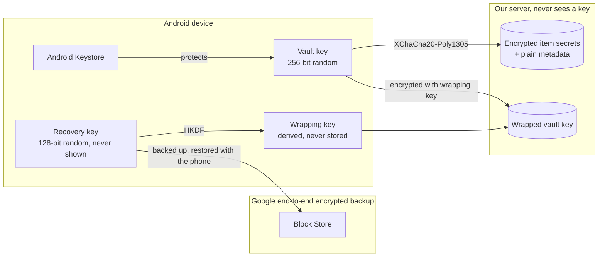
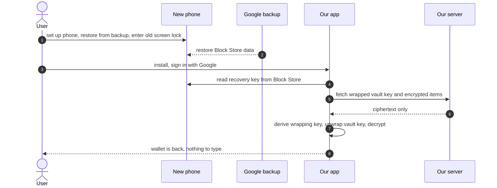

# ‏`ADR-001`: ניהול מפתחות והצפנה בצד הלקוח

- **סטטוס:** מקובל בכפוף לניסוי הטכני, גרסה 3 (2026-10-10).
- **מה השתנה בגרסה 3:** נוספה הוכחה שהמכשיר מחזיק את הכספת (החלטה 033), ו־`passkey` נוסף כמועמד ראשון בניסוי הטכני.
- **החלטות קשורות:** 003, 006, 008, 012, 018, 028, 029.
- **דרישות קשורות:** `AUTH-2` עד `AUTH-6`, `BAK-1`, `BAK-3`, `SEC-1`.
- **מה השתנה בגרסה 2:**
  - קוד השחזור כבר לא מוצג למשתמש. מפתח השחזור נשמר אוטומטית בגיבוי המוצפן של `Google`, דרך `Block Store`.
  - הנעילה היא ברמת הממשק.
  - הייצוא המוצפן הוסר.
  - הסיבה: המשתמש לא צריך לזכור שום דבר חדש (החלטות 028 ו־029).

## ההחלטה בקצרה

- **מפתח כספת אקראי** מצפין במכשיר את כל הסודות.
- **בשרת** נשמר עותק של מפתח הכספת, עטוף במפתח שנגזר ממפתח שחזור אקראי.
- **מפתח השחזור** נשמר אוטומטית בגיבוי המוצפן מקצה לקצה של `Google`, וחוזר לבד כשעוברים לטלפון חדש.
- **המשתמש לא צריך לזכור כלום** מלבד קוד הנעילה של הטלפון, שהוא כבר מכיר.
- **השרת שלנו** לא רואה לעולם אף מפתח.

## ההקשר

**מה מגינים עליו:** הסודות שמוגדרים בהחלטות 003 ו־006, כלומר פרטי המימוש וכל הטקסט החופשי.

**האיומים:**
- פריצה לשרת.
- אדמין או מפעיל.
- השתלטות על חשבון ה־`Google` של המשתמש.
- שרת פרוץ שמחליף נתונים מוצפנים בין פריטים.
- טלפון נעול שנגנב.
- דליפה דרך לוגים.

**הדרישות:**
- שחזור במכשיר חדש, **בלי שהמשתמש יזכור או ישמור שום דבר**.
- מימוש בלי חיבור לרשת.
- הרחבה בעתיד ל־`passkey`, לשיתוף ולארנק משפחתי.

**האילוצים:**
- `React Native` עם `Expo` (החלטה 022).
- קודם `Android`, ובהמשך `iOS` (החלטה 004).
- לא כותבים פרימיטיבים קריפטוגרפיים בעצמנו (החלטה 008).

## האפשרויות שנשקלו לשחזור

- **מפתח שמוחזק בשרת, בשירות ניהול מפתחות כמו `KMS`:**
  - הכי פשוט למשתמש.
  - אבל השרת יכול לפענח את הקודים, וזה סותר את החלטה 003 ואת המטרה של מינימום אחריות. **נפסלה.**
- **סיסמת־על:** עוד סיסמה לזכור, ושכחה שלה פירושה אובדן מידע. **נפסלה.**
- **קוד שחזור שהמשתמש שומר:** בטוח, אבל מעביר את האחריות למשתמש. זו הייתה גרסה 1 של המסמך. **נדחתה לבקשת המשתמש.**
- **מפתח שחזור ב־`Block Store`, הגיבוי המוצפן של `Android`:**
  - המשתמש לא רואה ולא שומר שום דבר.
  - הגיבוי של `Google` מוצפן מקצה לקצה, ונפתח בקוד הנעילה של הטלפון הישן (לאימות).
  - **נבחרה.**
- **`passkey` עם הרחבת `PRF`:**
  - גם היא לא דורשת לזכור כלום, ועובדת בין פלטפורמות.
  - התמיכה ב־`Android` וב־`React Native` עוד לא בשלה (לאימות). **נדחתה לעתיד,** כעטיפה נוספת.

## ההחלטה

### היררכיית המפתחות

- **מפתח הכספת (`vault key`):** 256 ביט אקראיים, שנוצרים במכשיר. הוא מצפין את כל הסודות.
- **מפתח השחזור (`recovery key`):**
  - 128 ביט אקראיים, שנוצרים במכשיר.
  - נשמרים ב־`Block Store` עם גיבוי לענן, ולא מוצגים למשתמש בשימוש רגיל.
- **מפתח העטיפה (`wrapping key`):** נגזר ממפתח השחזור ב־`HKDF-SHA256`, ואף פעם לא נשמר.
- **מפתח הכספת העטוף:** מפתח הכספת, מוצפן במפתח העטיפה ונשמר בשרת שלנו.

### למה `HKDF` ולא `Argon2id`

`Argon2id` איטי בכוונה, כדי להקשות על ניחוש של סיסמה חלשה. מפתח השחזור הוא 128 ביט אקראיים, ואין שום סיכוי לנחש אותו, ולכן `HKDF` המהיר מספיק. **את ה־`KDF` בוחרים לפי האנטרופיה של הקלט.**

### ההצפנה

- **אלגוריתם:** `XChaCha20-Poly1305` (`AEAD`) מתוך `libsodium`, עם `nonce` אקראי של 192 ביט לכל הצפנה.
- **`AAD`:** מזהה הפריט, שם השדה וגרסת הפורמט. כך שרת פרוץ לא יכול להעביר קוד מוצפן מפריט אחד לאחר.
- **פורמט:** גרסה, `nonce`, ואחריהם ה־`ciphertext` יחד עם תג האימות (החלטה 008).
- **ספרייה ל־`React Native`:** יש לוודא בניסוי טכני (לאימות). החלופה היא `AES-256-GCM`, דרך ספרייה מקורית מוכרת.

### שמירה במכשיר ונעילה

- **מפתח הכספת:** נשמר באחסון מאובטח שנשען על `Android Keystore`. המועמד הוא `expo-secure-store`.
- **בזיכרון:** המפתח נמצא בזיכרון רק כשהאפליקציה פתוחה.
- **נעילה ברמת הממשק (החלטה 028):** האפליקציה מבקשת אימות ביומטרי או את קוד הנעילה של המכשיר לפני שהיא נפתחת. המפתח עצמו לא קשור לאימות ברמת החומרה.
- **מכשיר בלי נעילה בקוד** (החלטות 028 ו־029):
  - **נעילה:** האפליקציה מבקשת קוד אפליקציה של 4 ספרות.
  - **הקוד לא משמש להצפנה.** יש לו רק 10,000 אפשרויות, ולכן כל מחשב יכול לנחש אותו מיד אם יקבל את המידע המוצפן. נעילת ממשק מגבילה את מספר הניסיונות, ומפתח הצפנה לא יכול להגביל אותם.
  - **גיבוי:** הגיבוי של `Google` כנראה לא מוצפן מקצה לקצה במצב הזה (לאימות). מפתח השחזור עדיין נשמר שם, כי כדי לפענח צריך גם את המפתח העטוף מהשרת שלנו.

### התהליכים

- **הגדרה ראשונה:**
  - נוצרים מפתח כספת ומפתח שחזור.
  - מפתח השחזור נשמר ב־`Block Store`, ומפתח הכספת העטוף נשלח לשרת.
  - המשתמש לא נדרש לעשות שום דבר.
- **בדיקת הגיבוי:**
  - אם הגיבוי מקצה לקצה לא זמין, למשל כי הגיבוי של `Google` כבוי, מוצג באנר "הגיבוי שלך לא מוגן", עם הסבר איך להפעיל אותו (`AUTH-2`).
  - צריך לוודא בניסוי שה־`API` מאפשר לבדוק את זה (לאימות).
- **טלפון חדש** (ראו תרשים הרצף):
  - המשתמש משחזר את הטלפון מהגיבוי של `Google`, כרגיל.
  - מתקינים את האפליקציה ומתחברים עם `Google`.
  - האפליקציה קוראת את מפתח השחזור מ־`Block Store`, פותחת את מפתח הכספת, והארנק חוזר (`AUTH-3`).
- **מפתח שחזור לא נמצא:**
  - הודעה ברורה.
  - שתי אפשרויות: להזין מפתח שחזור ידנית, אם נשמר, או להתחיל ארנק חדש (`AUTH-4`).
- **אפשרות מתקדמת:**
  - בהגדרות אפשר להציג את מפתח השחזור ולשמור אותו ידנית.
  - זה נועד בעיקר למעבר בין פלטפורמות, למשל ל־`iPhone`.
  - המפתח מוצג ב־`Crockford Base32`, בקבוצות של 4 תווים, עם תו ביקורת.
- **ייצוא:** קובץ `JSON` לא מוצפן, עם אזהרה שהוא כולל קודים (`BAK-3`). ייצוא מוצפן הוסר, כי בלי מפתח שהמשתמש מכיר אין לו שימוש.
- **מחיקת חשבון:**
  - השרת מוחק את המפתח העטוף ואת המידע המוצפן.
  - האפליקציה מוחקת את מפתח הכספת, ואת הרשומה ב־`Block Store`.
  - כל עותק ישן של המידע המוצפן הופך לחסר ערך (`crypto-shredding`) (`AUTH-6`).

### הוכחה שהמכשיר מחזיק את הכספת (החלטה 033)

- **הבעיה:** מי שהשתלט על חשבון ה־`Google` לא יכול לפענח קודים. אבל בלי הגנה נוספת הוא יכול להפוך למכשיר הפעיל, לדרוס פריטים, או למחוק את החשבון ואיתו את הגיבוי.
- **הפתרון:**
  - ממפתח הכספת נגזר זוג מפתחות חתימה מסוג `Ed25519`, דרך `HKDF` עם תווית נפרדת.
  - המפתח הציבורי נשמר בשרת כשהכספת נוצרת.
  - פעולות רגישות דורשות חתימה על אתגר חד־פעמי מהשרת:
    - מעבר למכשיר פעיל חדש (`AUTH-7`).
    - מחיקת חשבון מתוך האפליקציה (`AUTH-6`).
- **מחיקה מקישור ב־`web`:**
  - שם אין מכשיר שיכול לחתום, ולכן המחיקה נכנסת לתוקף אחרי 7 ימים.
  - בזמן הזה נשלחת התראת אבטחה, ואפשר לבטל את המחיקה.
- **מה לומדים:**
  - חתימות דיגיטליות.
  - שיטת `challenge–response`.
  - הפרדה בין מפתחות לפי ייעוד, בעזרת תוויות שונות ב־`HKDF`.

## הנימוק

- **השרת שלנו לא יכול לקרוא קודים,** וגם מי שמשתלט על חשבון ה־`Google` של המשתמש לא יכול. כדי לשחזר את הגיבוי צריך גם את קוד הנעילה של הטלפון הישן (לאימות).
- **המשתמש לא זוכר ולא שומר שום דבר חדש.** המורכבות עוברת אלינו.
- **הדלת נשארת פתוחה** ל־`passkey`, לשיתוף ולארנק משפחתי, בלי להצפין מחדש.

## המחיר

**מתי השחזור לא עובד:**
- הגיבוי של `Google` כבוי.
- מעבר ל־`iPhone`.
- איפוס מכשיר בלי שחזור מגיבוי.

במקרים האלה, בלי מפתח שחזור ששמור ידנית, הקודים אובדים.

**תלות ב־`Google`:** אנחנו סומכים על התכנון של הגיבוי המוצפן שלה.

**עוד עבודה עלינו:** כנראה צריך לכתוב מודול מקורי קטן ב־`Kotlin`, כדי להשתמש ב־`Block Store` מ־`Expo` (לאימות).

**מגבלות שנשארו מגרסה 1:**
- ב־`JavaScript` אי אפשר להבטיח שמפתח יימחק מהזיכרון.
- אי אפשר לבצע בשרת פעולות על סודות.

## ההשלכות

- **כל הקוד הקריפטוגרפי במודול קטן אחד, עם בדיקות:**
  - וקטורי בדיקה ידועים.
  - מפתח שגוי נכשל.
  - `ciphertext` ששונה נכשל.
  - `AAD` שלא תואם נכשל.
  - גרסה לא מוכרת מחזירה שגיאה ברורה.
- **מלכודות בלוגים:** מפתח הכספת ומפתח השחזור נכללים בבדיקת המלכודות של `SEC-2`.
- **ניסוי טכני לפני שבונים:**
  - ספרייה של `libsodium` שעובדת עם `Expo`.
  - גישה ל־`Block Store` מ־`Expo`, בספרייה קיימת או במודול מקורי.
  - איך מזהים שהגיבוי מקצה לקצה זמין.
  - שחזור אמיתי: גם העברה ישירה מטלפון לטלפון, וגם שחזור מהענן.
  - הסרה של האפליקציה והתקנה מחדש באותו טלפון: האם `Block Store` שורד אותה.
  - **מועמד ראשון: `passkey` עם הרחבת `PRF`, דרך מנהל הסיסמאות של `Google`.**
    - אם הוא עובד, בטלפון חדש מספיק להתחבר לחשבון `Google` ולהזין את קוד ה־`PIN` של מנהל הסיסמאות, או את קוד הנעילה של הטלפון הישן.
    - אין צורך לשחזר את כל הטלפון מגיבוי.
    - **הסדר:** אם `passkey` עובד, הוא העטיפה הראשית. אם לא, `Block Store`. אם גם זה לא, שמירה במנהל הסיסמאות דרך `Credential Manager`.

## מה זה מכסה ומה לא

**מכוסה:**
- פריצה לשרת שלנו.
- אדמין.
- השתלטות על חשבון `Google`.
- שרת שמחליף נתונים מוצפנים בין פריטים.
- טלפון נעול שנגנב.

**לא מכוסה:**
- נוזקה על מכשיר פתוח.
- מי שיודע את קוד הנעילה של הטלפון וגם יכול להיכנס לחשבון ה־`Google` של המשתמש.
- מישהו שמציץ במסך בקופה.

## מה לומדים כאן

- **`envelope encryption`:** מפתח שמצפין מפתח.
- **`AEAD` ו־`AAD`.**
- **בחירת `KDF` לפי אנטרופיה.**
- **`crypto-shredding`.**
- **`crypto agility`** בעזרת מספר גרסה.
- **העברת מורכבות מהמשתמש למערכת,** ושימוש ביכולות של הפלטפורמה במקום להמציא אותן.
- **מודול מקורי ב־`Expo`:** הגשר בין `JavaScript` ל־`Kotlin`.
