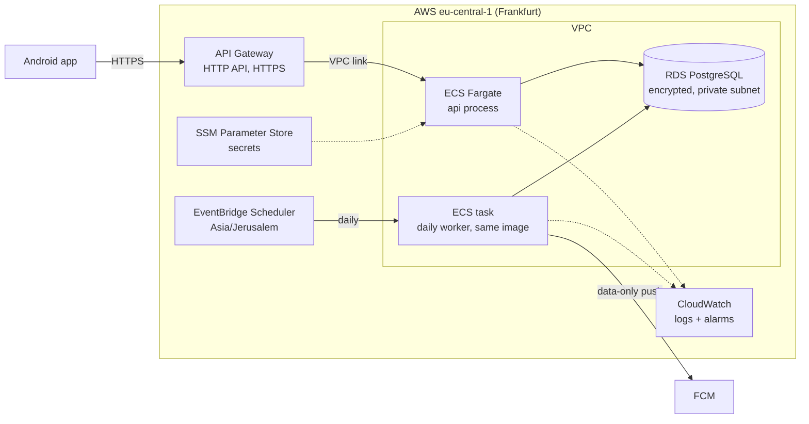

# ‏`ADR-003`: אירוח, ותשלום רק כשיש משתמשים

- **סטטוס:** מקובל (2026-11-15).
- **החלטות קשורות:** 005, 026, 032, 036, 038, 039.
- **מסמכים קשורים:** [architecture.md](../architecture.md), [ADR-002](ADR-002-technology.md), [threat-model.md](../threat-model.md).
- **המחירים:** נבדקו ב־2026-11-15, לפי מחירון ה־`API` של `AWS` לאזור `eu-central-1`. מחירים משתנים, ולכן בודקים אותם שוב לפני כל שלב.

## ההחלטה בקצרה

- **לא משלמים על ענן לפני שיש משתמשים.** בפיתוח ובשלב הבודקים העלות היא $0.
- **הקוד מוכן לענן מהיום הראשון:** `image` אחד של `Docker`, ‏`PostgreSQL` רגיל, וכל ההגדרות במשתני סביבה. כך המעבר בין השלבים הוא הגדרה, ולא שכתוב.
- **היעד אחרי הפרסום:** ‏`AWS` בפרנקפורט (`eu-central-1`), בכ־$28.5 עד $29.5 לחודש.

## ההקשר

- **אין עדיין משתמשים:** האפליקציה בפיתוח, ובשלב 1 יהיו רק 2 עד 3 בודקים (החלטה 026).
- **המשתמש החליט:** לא לשלם שקל על תשתית עד שהאפליקציה מוכנה ומתפרסמת, ואז לפתוח בהדרגה.
- **שירותים גדולים ומנוהלים** (החלטה 032), ו־`AWS` מוכר למשתמש.
- **מה התשתית צריכה לספק בסוף:**
  - ‏`image` אחד שרץ כ־`api` וכ־`worker` (`architecture.md`).
  - ‏`PostgreSQL` מנוהל, מוצפן, עם גיבוי יומי שנשמר 14 יום בלבד (`PRIV-2`).
  - מתזמן לסריקה היומית, והתראה אם היא לא רצה עד 10:30.

## ההחלטה

### שלב א': פיתוח, ‏$0

- **הכול רץ מקומית:** השרת ו־`PostgreSQL` ב־`Docker Compose`, במחשב של המפתח.
- **הטלפון מגיע לשרת דרך מנהרה חינמית,** כמו ש־`Metro` עבד בניסוי 01. הכלי ייבחר כשמקימים את הסביבה, למשל `cloudflared` או `ngrok` (הנחה).
- **אין חשבון ענן, ואין חשבונית.**

### שלב ב': 2 עד 3 בודקים, ‏$0

- **הצורך:** שרת שזמין תמיד, גם כשהמחשב כבוי.
- **הבחירה:** חשבון `AWS` בתוכנית החינמית (`Free plan`), בפרנקפורט, עם ארכיטקטורת היעד של שלב ג'.
  - **קרדיטים:** עד $200, לתקופה של עד 6 חודשים ([AWS](https://aws.amazon.com/blogs/aws/aws-free-tier-update-new-customers-can-get-started-and-explore-aws-with-up-to-200-in-credits/)).
  - **למה אין סיכון לחיוב:** התוכנית החינמית לא מחייבת כרטיס. כשהקרדיטים או הזמן נגמרים, משדרגים או שהחשבון נסגר (לפי אותו מקור).
  - **יתרון:** הבודקים עובדים על אותה תשתית שתשמש אחרי הפרסום, ולכן אין מעבר נוסף.
- **לאימות לפני שלב ב':**
  - שהתוכנית החינמית מאפשרת `ECS Fargate`. ש־`RDS` מותר בה כבר נמצא ([AWS](https://aws.amazon.com/rds/free/)).
  - המחירים והתנאים, שוב.
- **חלופה אם זה לא עובד, גם היא ב־$0:**
  - ‏`AWS Lambda` מהשכבה החינמית שלא פגה, עם `PostgreSQL` חינמי מספק חיצוני בפרנקפורט, למשל `Neon` (לאימות).
  - **המחיר:** גיבויים קצרים, ומבנה שונה מהיעד. לכן זו רק חלופה.

### שלב ג': אחרי הפרסום, כ־$28.5 עד $29.5 לחודש

- **השרת:** ‏`ECS Fargate`, ‏`ARM`, ‏0.25 `vCPU` ו־0.5 `GB`. כ־$8.29 לחודש, ועוד $3.65 לכתובת `IP` ציבורית ([AWS](https://aws.amazon.com/blogs/aws/new-aws-public-ipv4-address-charge-public-ip-insights/)).
- **`HTTPS`:** ‏`API Gateway HTTP API` דרך `VPC link`, בלי `ALB`. עולה $1 למיליון בקשות, כלומר כמעט כלום ([AWS](https://aws.amazon.com/api-gateway/pricing/)).
- **מסד הנתונים:** ‏`RDS PostgreSQL`, ‏`db.t4g.micro`, ‏20 `GB`. כ־$16.61 לחודש.
  - מוצפן, ב־`subnet` פרטי, ולא נגיש מהאינטרנט.
  - גיבוי אוטומטי שנשמר 14 יום. אחסון הגיבויים חינמי עד גודל מסד הנתונים ([AWS](https://docs.aws.amazon.com/AmazonRDS/latest/UserGuide/USER_WorkingWithAutomatedBackups.html)).
  - הגנה ממחיקה בטעות (`deletion protection`).
- **הסריקה היומית:** ‏`EventBridge Scheduler` מפעיל את אותו `image` כמשימה חד־פעמית ב־`ECS`, לפי אזור הזמן `Asia/Jerusalem`. חינמי בכמות שלנו ([מחירים](https://aws.amazon.com/eventbridge/pricing/), [אזורי זמן](https://docs.aws.amazon.com/scheduler/latest/UserGuide/schedule-types.html)).
- **הגדלה:** רק מהשלב הזה, ובהדרגה, לפי השימוש בפועל.

### בכל השלבים בענן

- **תשתית כקוד:** ‏`AWS CDK` ב־`TypeScript`, ב־`workspace` בשם `infra`. את הסביבה אפשר לבנות מחדש מתוך ה־`repo`, ולא מלחיצות בממשק.
- **פריסה:** ‏`GitHub Actions` בונה את ה־`image`, מעלה אותו ל־`ECR` ופורס. ההתחברות ל־`AWS` היא דרך `OIDC`, בלי מפתחות קבועים.
- **סודות:** ב־`SSM Parameter Store` (הנחה: השכבה הרגילה חינמית).
- **הגנה על החשבון:**
  - ‏`MFA` למשתמש ה־`root`, ומשתמש נפרד לעבודה שוטפת.
  - התראת תקציב ב־$1, כדי שכל חיוב שהוא יופיע מיד.
- **ניטור:** ‏`CloudWatch`, עם התראות במייל: הסריקה לא רצה עד 10:30, ושיעור שגיאות חריג ב־`API`.

## חלופות שנשקלו

- **`AWS` בתל אביב (`il-central-1`):**
  - **בעד:** המידע נשאר בישראל, ושאלת ההעברה לחו"ל לא עולה בכלל.
  - **נגד:** ‏`Fargate` יקר שם בכ־11%, ‏`Lightsail` לא זמין שם, ואולי צריך להפעיל את האזור ידנית (לאימות).
  - **ההחלטה:** פרנקפורט. ההבדל בזמן התגובה הוא כ־50 `ms` ([WonderNetwork](https://wondernetwork.com/pings/Tel%20Aviv/Frankfurt)), וזה לא משמעותי אצלנו.
- **`App Runner`:** סגור ללקוחות חדשים ([AWS](https://docs.aws.amazon.com/apprunner/latest/dg/apprunner-availability-change.html)).
- **`Lightsail`:** מסד הנתונים הזול שלו לא מוצפן, והגיבויים האוטומטיים בו נשמרים רק 7 ימים ([AWS](https://aws.amazon.com/lightsail/pricing/)). זה לא עומד בדרישות.
- **`ALB` במקום `API Gateway`:** מוסיף כ־$27 לחודש, ולא נותן לנו שום דבר בשלב הזה.
- **`Lambda` עם `RDS`:** כדי להגיע למסד נתונים פרטי, `Lambda` צריך לרוץ בתוך הרשת. אז הוא צריך `NAT gateway` כדי לפנות לאינטרנט, ל־`Google` ול־`FCM`, וזה עולה כ־$33 לחודש ומעלה (לאימות). זה גם שובר את המבנה של `image` אחד.
- **`Google Cloud Run` ב־`me-west1`:**
  - **בעד:** כ־$11 עד $12 לחודש (הערכה), ‏`HTTPS` מובנה, וירידה לאפס כשאין שימוש ([Cloud Run](https://cloud.google.com/run/pricing), [Cloud SQL](https://docs.cloud.google.com/sql/docs/postgres/pricing)).
  - **נגד:** אנחנו כבר תלויים ב־`Google` בהתחברות, ב־`passkey` ובהתראות. גם השרת שם פירושו שבעיה אחת בחשבון `Google` עוצרת הכול. ו־`AWS` מוכר למשתמש.

## היבט משפטי

**זה לא ייעוץ משפטי.** זו קריאה של המקורות, וצריך לאמת אותה לפני שיש משתמשים אמיתיים.

- **אחסון בפרנקפורט מותר, כנראה:**
  - לפי תקנות הגנת הפרטיות (העברת מידע למאגרי מידע שמחוץ לגבולות המדינה) מ־2001, מותר להעביר מידע למדינה שמצטרפת לאמנה 108 של מועצת אירופה. גרמניה צד לאמנה ([DLA Piper](https://www.dlapiperdataprotection.com/?c=IL)).
  - **תנאי:** התקנות דורשות גם התחייבות של הספק שלא יעביר את המידע הלאה. **לאימות לפני שלב ב':** האם הסכם עיבוד הנתונים הרגיל של `AWS` מכסה את זה.
- **תיקון 13** (בתוקף מ־14 באוגוסט 2025): לא נדרש רישום מאגר, ולא נדרש ממונה הגנת פרטיות, בהיקף שלנו (לפי אותו מקור).
- **תקנות אבטחת מידע מ־2017:**
  - כל עוד יש גישה לכל היותר ל־3 אנשים, ופחות מ־10,000 משתמשים, המאגר כנראה נחשב "מאגר בניהול יחיד" ([התקנות](https://www.gov.il/BlobFolder/legalinfo/data_security_regulation/en/5777%E2%80%932017.pdf)).
  - לקטגוריה הזו יש רשימה קצרה של חובות, למשל מסמך הגדרות מאגר ותיעוד של אירועי אבטחה.
- **ה־`metadata` של הפריטים** הוא כנראה מידע אישי, כי הוא קשור לחשבון.

## הנימוק

- **אין משתמשים, ולכן אין סיבה לשלם.** כל דולר לפני הפרסום הוא הוצאה בלי תועלת.
- **ארכיטקטורת היעד כבר בשלב הבודקים:** כשמפרסמים, רק משדרגים את החשבון. לא בונים תשתית חדשה ברגע הלחוץ.
- **הקוד לא תלוי בספק:** אם `AWS` לא יתאים, אפשר לעבור לספק אחר בלי לשנות את הקוד.

## המחיר

- **מגבלת זמן:** הקרדיטים מחזיקים עד 6 חודשים. אם הבודקים יתחילו מוקדם מדי, התקופה תיגמר לפני הפרסום.
- **פיתוח מקומי:** הסביבה המקומית שונה מעט מהענן, למשל `Docker Compose` לעומת `ECS`.
- **אחרי הפרסום:** כ־$29 לחודש, גם עם מעט משתמשים.

## לאימות

- שהתוכנית החינמית של `AWS` מאפשרת `ECS Fargate`, ומה קורה בדיוק בסוף התקופה.
- שהסכם עיבוד הנתונים של `AWS` מכסה את ההתחייבות שהתקנות דורשות.
- ש־`SSM Parameter Store` בשכבה הרגילה חינמי.
- איזה כלי מנהרה מתאים לשלב א'.
- כל המחירים, שוב, לפני שלב ב' ולפני שלב ג'.

## ההשלכות

- **שלב א' הוא הצעד הבא בקוד:** ‏`Docker Compose` לשרת ול־`PostgreSQL`, יחד עם שלד ה־`workspaces` מ־`ADR-002`.
- **`architecture.md`:** "כמה עשרות דולרים בחודש" הופך להערכה לשלב ג'.
- **`threat-model.md`:** כדאי להוסיף סעיף קצר על ההיבט המשפטי, לפני שלב ב'.

## מה לומדים כאן

- **הפרדה בין הקוד לבין המקום שבו הוא רץ:** ‏`image` אחד, ומשתני סביבה.
- **תשתית כקוד:** סביבה שאפשר לבנות מחדש, ולא שרת שנבנה בלחיצות.
- **עלויות ענן:** מה באמת עולה כסף בחשבון קטן, למשל כתובת `IP` ציבורית ו־`load balancer`.
