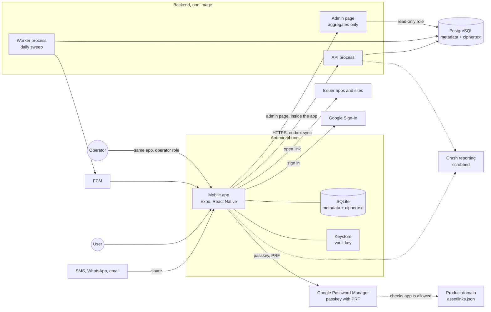
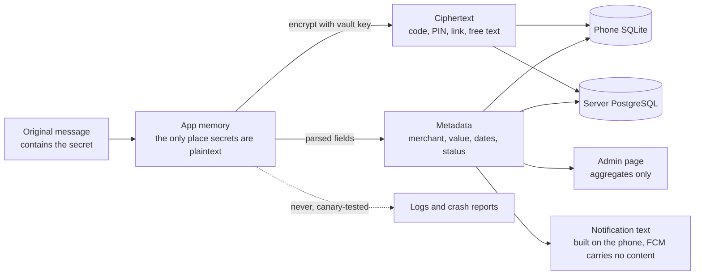
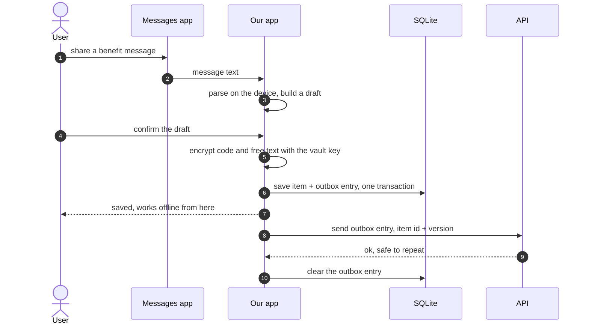
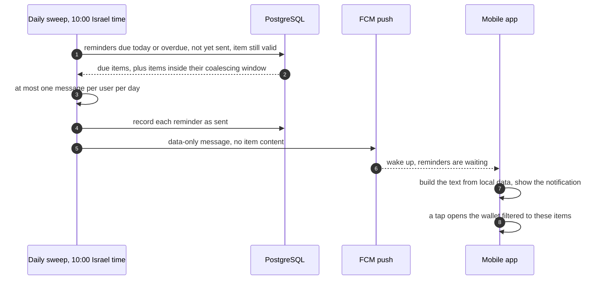

# ארכיטקטורה: שלב 1

- **עודכן:** 2026-10-23. השחזור עודכן ל־`passkey` עם `PRF` (החלטה 034).
- **מצב:** טיוטה ראשונה.
- **מסמכים קשורים:** [prd.md](prd.md), [domain-model.md](domain-model.md), [ADR-001](adr/ADR-001-key-management.md), [decision-log.md](decision-log.md).

כל תרשים כאן כתוב בקוד `Mermaid`, וזה מקור האמת. כשהארכיטקטורה משתנה, משנים את התרשים ואת הטקסט באותו עדכון.

## העקרונות שמעצבים את הארכיטקטורה

- **`local-first`:**
  - המכשיר הוא מקור האמת.
  - המימוש עובד בלי חיבור לרשת (החלטה 007).
- **כותב יחיד:** בשלב 1 רק מכשיר אחד כותב (החלטה 009).
- **השרת לא קורא סודות:** החלטות 003 ו־006, ו־`ADR-001`.
- **הכי פשוט שעובד:**
  - קוד אחד לשרת, שנבנה ל־`image` אחד.
  - אין `microservices` ואין `Kubernetes`.

## עץ המערכת

```text
Coupon Wallet (stage 1)
├── Mobile app (Expo, React Native, TypeScript)
│   ├── Auth: Google Sign-In, app lock (device auth or 4-digit app PIN)
│   ├── Vault: crypto module, Keystore, passkey with PRF
│   ├── Capture: share target, parser, manual form
│   ├── Wallet: list, derived states, totals
│   ├── Redeem: offline code screen, return prompt
│   ├── Local store: SQLite (metadata + ciphertext), outbox
│   ├── Sync: single writer, pushes the outbox to the API
│   ├── Notifications: FCM receiver, separate channels
│   └── Export: plain JSON with a warning
│
├── Backend (Node.js, TypeScript, one codebase, one image)
│   ├── API process: sessions, vault, items, devices, account deletion
│   ├── Worker process: daily reminder sweep
│   └── Admin page: aggregates + health, opened inside the app, operator only
│
├── Data
│   ├── PostgreSQL: users, identities, items (metadata + ciphertext),
│   │   wrapped vault keys, active device, push tokens, reminder log
│   └── Phone: SQLite + Keystore
│
├── External services
│   ├── Google Sign-In
│   ├── Google Password Manager (passkey, end-to-end encrypted sync)
│   ├── Firebase Cloud Messaging
│   └── Crash reporting (scrubbed)
│
└── Delivery & operations
    ├── CI: unit tests, parser fixtures, simulated months, canary-code check
    ├── EAS Build → Google Play internal testing
    ├── Container hosting + managed PostgreSQL (provider: ADR-003)
    ├── Product domain: public assetlinks.json (passkey RP ID)
    └── Monitoring & alerts: API errors, sweep ran, push failures
```

## הרכיבים ואיך הם מחוברים



- **השרת הוא `modular monolith`:**
  - קוד אחד, שנבנה ל־`image` אחד, ורץ כשני תהליכים: `api` ו־`worker`.
  - המודולים מופרדים בתוך הקוד, ולא ברשת.
  - כך יש פחות חלקים להפעיל, לנטר ולתחזק. אם יהיה צורך, אפשר לפצל את השרת אחר כך.
- **ה־`backoffice` הוא דף ניהול אחד, שנפתח מתוך האפליקציה** (החלטה 031):
  - השרת מייצר את הדף, והאפליקציה פותחת אותו בתצוגה פנימית, עם ה־`session` של המפעיל.
  - השרת בודק את הרשאת המפעיל. לפני הפתיחה נדרש אימות ביומטרי, וכל כניסה נרשמת.
  - הדף קורא מ־`PostgreSQL` עם משתמש מסד נתונים שיש לו הרשאת קריאה בלבד.
  - בשלב 1 הוא מציג רק נתונים מצרפיים (החלטה 027).
- **`Firebase`:** משמש רק ל־`FCM`, ערוץ ההתראות של `Android`. לא משמש לאחסון ולא לגיבוי (החלטה 032).

## איפה המידע הרגיש נמצא



- **טקסט גלוי:** סודות קיימים כטקסט גלוי רק בזיכרון של האפליקציה, ורק לזמן קצר.
- **אותו פורמט מוצפן בכל מקום:** בטלפון ובשרת. כך הגיבוי פשוט, והמידע מוגן גם כשהוא שמור בטלפון עצמו.
- **מה לא נשמר אף פעם:** ההודעה המקורית נשמרת רק מוצפנת, בתוך `encryptedDetails`. בלוגים ובדוחות קריסה אין סודות, וזה נבדק בבדיקת המלכודות (`SEC-2`).
- **אנליטיקה:** אין כלי אנליטיקה של צד שלישי בשלב 1 (החלטה 030).
  - המדדים מחושבים מהמידע שכבר נמצא בשרת.
  - זמן ההוספה וערוץ ההוספה נשלחים כשדות `metadata` של הפריט.
  - כך יש פחות גורמים שמעבדים מידע, ופחות מקומות שממנו הוא יכול לדלוף.

## זרימות מרכזיות

### הוספת פריט



### תזכורת לפני פקיעה



### שחזור בטלפון חדש

הזרימה מתוארת ב־[ADR-001](adr/ADR-001-key-management.md). בקצרה: מתחברים בטלפון לחשבון `Google`, וה־`passkey` שמסתנכרן אליו פותח את הכספת. אין צורך לשחזר את כל הטלפון מגיבוי (החלטה 034).

- **הדומיין של המוצר:** משמש `RP ID` ל־`passkey`. בשורש שלו מתפרסם קובץ ציבורי בשם `assetlinks.json`, שמאשר לאפליקציה להשתמש בדומיין.
- **הרשאת הכתיבה לדומיין רגישה:** מי שיכול לשנות את הקובץ יכול לאשר אפליקציה אחרת. לכן מגינים על הרשאת הכתיבה לאתר.

## סנכרון עם כותב יחיד

- **`outbox`:**
  - כל שינוי נשמר באותה טרנזקציה גם בפריט וגם בטבלת `outbox` מקומית.
  - כשיש חיבור, ה־`outbox` נשלח לשרת. אם האפליקציה נסגרת באמצע, שום שינוי לא הולך לאיבוד.
- **גרסה לכל פריט:**
  - לכל פריט יש מונה גרסה, והשרת שומר רק גרסה חדשה יותר מזו שכבר יש לו.
  - שליחה חוזרת של אותה גרסה לא עושה כלום (`idempotency`).
- **המכשיר הפעיל:**
  - השרת שומר איזה מכשיר הוא הכותב היחיד.
  - טלפון ששוחזר הופך לכותב החדש, אבל רק אחרי שהוכיח שהוא מחזיק את הכספת (`ADR-001`, `AUTH-7`).
  - אם הטלפון הישן מנסה לכתוב, השרת דוחה את הכתיבה, והטלפון הישן עובר למצב קריאה בלבד.
  - המושג הזה נקרא `fencing`.
- **מחיקה:** פריט שנמחק נשלח לשרת כסימון מחיקה, כדי שהמחיקה תעבור דרך ה־`outbox` כמו כל שינוי אחר.

## ה־`API`, בקווים כלליים

הפירוט המלא יהיה ב־`api-design.md`.

- **התחברות:** אימות הטוקן של `Google`, הנפקת `access token` קצר מועד, ורענון עם `refresh token` מתחלף.
- **כספת:** קריאה ושמירה של מפתח הכספת העטוף.
- **פריטים:**
  - שמירת פריט לפי מזהה וגרסה.
  - מחיקת פריט.
  - שליפה מלאה לצורך שחזור.
- **מכשירים:** רישום של טוקן התראות, ובחירת המכשיר הפעיל.
- **חשבון:** מחיקה מלאה (`AUTH-6`).
- **מפעיל:** נתונים מצרפיים ובריאות המערכת (`OPS-1` ו־`OPS-2`).

## תשתית ופריסה

- **הבנייה:**
  - ה־`CI` מריץ את כל הבדיקות, כולל דוגמאות ה־`parser`, החודשים המדומים ובדיקת המלכודות.
  - האפליקציה נבנית ב־`EAS Build`, ומופצת לבדיקה הפנימית ב־`Google Play`.
- **השרת:**
  - `image` אחד, שרץ על שירות שמריץ `containers`.
  - `PostgreSQL` מנוהל, עם גיבוי יומי.
  - הסריקה היומית מופעלת על ידי מתזמן של הספק.
- **הספק:**
  - נבחר ב־`ADR-003`.
  - בגלל `Docker`, אפשר לעבור לספק אחר בלי לשנות את הקוד.
- **סביבות:** בשלב 1 יש שתיים בלבד. סביבה מקומית לפיתוח, וסביבה אחת שבה הבודקים עובדים.

## ניטור ותפעול

- **לוגים:**
  - לוגים מובנים, בלי סודות.
  - בלי גוף הבקשה בנתיבים שמעבירים מידע מוצפן.
- **מדדים:**
  - שגיאות ב־`API`.
  - זמני תגובה.
  - הצלחה של הסריקה היומית.
  - כשלים במשלוח התראות.
- **התראות למפעיל:**
  - הסריקה לא רצה עד 10:30.
  - שיעור שגיאות חריג ב־`API`.
- **דוחות קריסה:** עוברים סינון לפני שהם יוצאים מהמכשיר.

## סקירה ספקנית (2026-10-10)

עברתי על הארכיטקטורה, על `ADR-001` ועל ה־`PRD` משלוש נקודות מבט: של תוקף, של מפעיל שמתעורר בשלוש בלילה, ושל מי שמחפש מה מיותר. הממצאים מסודרים לפי חומרה. **כל ששת התיקונים אושרו (החלטה 033), ושולבו ב־`PRD`, ב־`ADR-001` ובמסמך הזה.**

### ממצא 1, חמור: השתלטות על חשבון `Google` יכולה למחוק את הגיבוי

- **הבעיה:** מי שנכנס לחשבון ה־`Google` של המשתמש לא יכול לפענח קודים. אבל לפי התכנון הנוכחי הוא כן יכול:
  - להפוך למכשיר הפעיל.
  - לדרוס או למחוק פריטים בשרת.
  - למחוק את החשבון. מחיקה מפעילה `crypto-shredding`, והגיבוי אובד.
- **התיקון המוצע: הוכחה שהמכשיר מחזיק בכספת (`proof of possession`).**
  - ממפתח הכספת נגזר זוג מפתחות חתימה (`Ed25519`). המפתח הציבורי נשמר בשרת כשהכספת נוצרת.
  - כדי להפוך למכשיר הפעיל, או כדי למחוק חשבון מתוך האפליקציה, המכשיר חותם על אתגר שהשרת שולח. רק מי שמחזיק את מפתח הכספת יכול לחתום.
  - מחיקה דרך הקישור ב־`web`, שנדרשת לפי `Google Play`, נכנסת לתוקף רק אחרי 7 ימים. בזמן הזה נשלחת התראת אבטחה למכשיר הפעיל, ואפשר לבטל את המחיקה.
- **מה לומדים:** חתימות דיגיטליות, ושיטת `challenge–response`.

### ממצא 2, בינוני: תוכן ההתראות עובר דרך `Google`

- **הבעיה:** הודעה כמו "2 קופונים של שופרסל פגים בקרוב" עוברת ב־`FCM` כטקסט. ויתרנו על אנליטיקה של צד שלישי בגלל פרטיות, ובאותו זמן אנחנו שולחים `metadata` ל־`Google`.
- **התיקון המוצע:**
  - השרת שולח הודעת `data` בלי תוכן, שאומרת רק "יש תזכורות".
  - האפליקציה בונה את הטקסט בעצמה, מהמידע שכבר שמור בה.
- **לאימות בניסוי:** שהאפליקציה מתעוררת באמינות להודעה כזו. אם לא, שולחים טקסט כללי, בלי שם רשת ובלי סכום.

### ממצא 3, בינוני: ההימור הכי גדול נבדק הכי מאוחר

- **הבעיה:** העיקרון "לא לזכור כלום" נשען כולו על `Block Store` מתוך `Expo`, ואת זה עוד לא בדקנו. הניסוי מתוכנן רק לסוף שלב הארכיטקטורה.
- **התיקון המוצע:**
  - להקדים את הניסוי, לפני `ADR-002` ו־`ADR-003`.
  - להכין תוכנית חלופית: לשמור את מפתח השחזור במנהל הסיסמאות של `Google`, דרך `Credential Manager`. זו לחיצה אחת על "שמור", ועדיין לא צריך לזכור כלום.
- **לבדוק גם:** מה קורה כשמסירים את האפליקציה ומתקינים אותה מחדש באותו טלפון. המפתח ב־`Keystore` נמחק בהסרה, והשאלה היא אם `Block Store` שורד אותה (לאימות).
- **מה קרה בפועל (2026-10-23):**
  - הניסוי הוקדם ונערך. המפתח ב־`Keystore` אכן נמחק בהסרה.
  - ‏`passkey` עם `PRF` עבר, ולכן לא היה צורך ב־`Block Store` או בתוכנית החלופית (החלטה 034).
  - הפרטים ב־`docs/spikes/spike-01-key-recovery.md`.

### ממצא 4, קל: סריקה שלא רצה מאבדת תזכורות

- **הבעיה:** אם הסריקה נופלת ביום מסוים, תזכורת "יום לפני" של אותו יום לא תישלח לעולם.
- **התיקון המוצע:**
  - הסריקה שולחת כל תזכורת שהמועד שלה הגיע או עבר, שעוד לא נשלחה, ושהפריט שלה עדיין בתוקף.
  - הרישום של מה שנשלח נעשה לכל תזכורת בנפרד, ולא רק לפי "משתמש + תאריך". כך אין כפילויות גם כשמשלימים יום שהוחמץ.

### ממצא 5, קל: קודים נחשפים בתצוגת האפליקציות האחרונות

- **הבעיה:**
  - `Android` שומר צילום של המסך האחרון בתצוגת האפליקציות האחרונות. אם זה היה מסך המימוש, הקוד מופיע שם.
  - גם כלים לדוחות קריסה יכולים לצלם את המסך.
- **התיקון המוצע:**
  - מסכים שמציגים סודות מוסתרים בתצוגת האפליקציות האחרונות.
  - דוחות הקריסה לא כוללים צילומי מסך, ולא טקסט מהממשק.
  - המשתמש עדיין יכול לצלם מסך ביוזמתו.

### ממצא 6, קל: גיבויים של מסד הנתונים שומרים מידע של משתמשים שנמחקו

- **הבעיה:** הסודות מוגנים בזכות `crypto-shredding`, אבל ה־`metadata` של משתמש שנמחק נשאר בגיבויים הישנים של `PostgreSQL`.
- **התיקון המוצע:**
  - גיבויים נשמרים 14 יום בלבד.
  - מדיניות הפרטיות מציינת שהמחיקה מושלמת תוך 14 יום.

### מה בדקתי ונראה תקין

- **אין רכיב מיותר:**
  - `modular monolith`, `outbox`, `fencing` ומשתמש מסד נתונים לקריאה בלבד הם כולם בגודל המתאים.
  - כל רכיב נשען על דרישה עם מזהה, ואף אחד מהם לא נבנה "ליתר ביטחון".
- **עלות (הערכה):** כמה עשרות דולרים בחודש, עבור שירותים מנוהלים אצל ספק ענן גדול. העלות תפורט ב־`ADR-003`.

## `ADR` שצפויים בהמשך

- **`ADR-002`, פרטי הטכנולוגיה:**
  - מודולים של `Expo`.
  - `framework` לשרת.
  - גישה למסד הנתונים.
  - ספריית ההצפנה. ‏`react-native-libsodium` כבר נבדקה ועבדה בניסוי 01.
- **`ADR-003`, ספק ענן ואירוח.**
- **`ADR-004`:** הפרוטוקול של הסנכרון וה־`fencing`, אם יתברר שהם מורכבים מכפי שמתואר כאן.

## שאלות פתוחות

- **התנגשות בין חשבונות:** מה קורה כשמשתמש מתחבר לאפליקציה עם חשבון `Google` אחר מזה שה־`passkey` שמור בו? זה לא נבדק בניסוי 01.
- **עטיפה שנייה למפתח הכספת, ודומיין למוצר:** שתי שאלות פתוחות מהחלטה 034. הפרטים ביומן ההחלטות.
