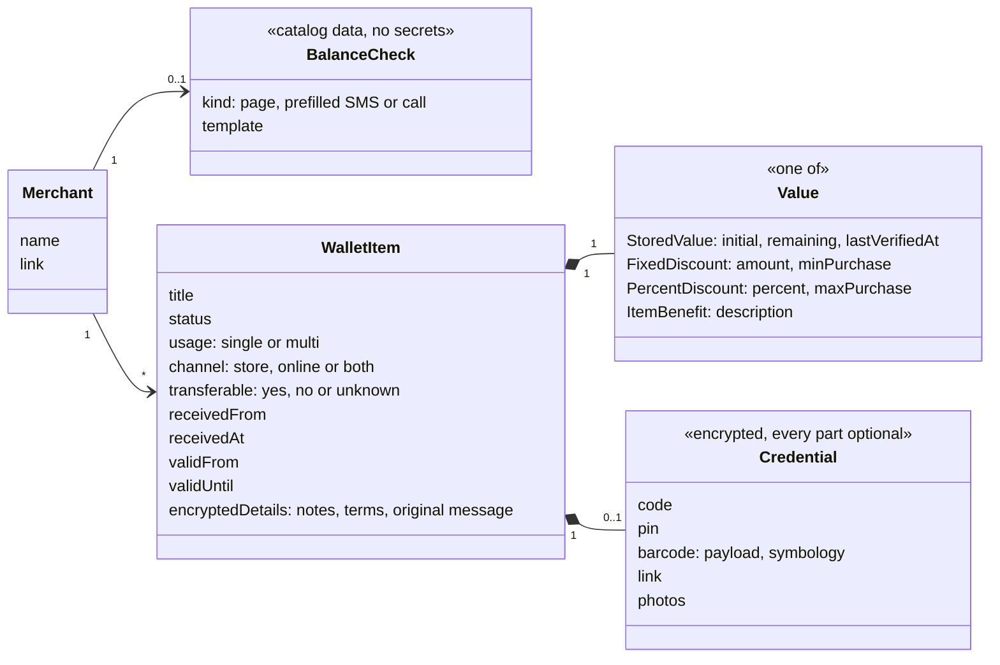
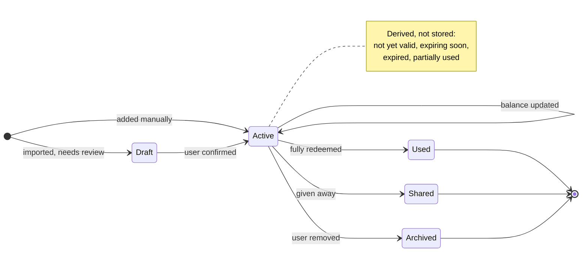

# מודל ה־`domain`

- **עודכן:** 2026-10-09.
- **מצב:** טיוטה ראשונה, שמבוססת על שמונה דוגמאות אמיתיות. המודל ישתנה כשיגיעו דוגמאות חדשות.

## מטרת המסמך

המסמך מגדיר את השפה המשותפת של המוצר: אילו מושגים קיימים, מה הקשר ביניהם, ואילו כללים שומרים עליהם. הקוד, ה־`API` ומסד הנתונים ייגזרו ממנו.

## העיקרון המרכזי

**אין ישות `Coupon` אחת.** כל פריט בארנק מורכב משני חלקים בלתי תלויים:
- **הערך:** כמה הפריט שווה.
- **פרטי המימוש:** איך משתמשים בו.

₪500 ב־`BuyMe` ו־₪500 בכרטיס מתנה פיזי שווים אותו דבר, אבל המימוש שלהם שונה לגמרי.

## הדוגמאות שעליהן המודל מבוסס

אף דוגמה כאן לא כוללת קוד או מספר כרטיס.
- **`BuyMe ALL`:** כרטיס מתנה דיגיטלי עם יתרה. הקוד בו דינמי, והיתרה מוצגת רק אחרי התחברות.
- **ג'מבו:** הנחה קבועה, בתנאי קנייה מינימלית, מהמעסיק.
- **`Foot Locker`:** הנחה באחוזים, מהמעסיק. אישית ולא ניתנת להעברה.
- **פודאפיל:** שובר להחלפה של מארז שי.
- **שני כרטיסי `Swish` של ₪100:** כרטיסי מתנה פיזיים, עם מספר כרטיס, `CVV` וקוד `QR`.
- **כרטיס `Swish` של ₪655 מכללית:** כרטיס מתנה פיזי עם מספר כרטיס, `CVV` וברקוד נפרד.
- **קופון חג מ־`Crazyline`:**
  - הנחה קבועה של ₪80, אונליין בלבד, עם קוד שמשלב אותיות וספרות.
  - הוא הגיע יחד עם מבצע פומבי מאותו שולח, והמבצע הפומבי לא נכנס לארנק.
- **`FOX HOME`:** שובר שהובטח ועוד לא הונפק. הוא מחוץ לתחום, לפי החלטה 013.

## מילון המושגים

- **פריט בארנק (`WalletItem`):** כל הטבה אישית שהמשתמש מחזיק.
- **בית עסק (`Merchant`):**
  - המקום שבו משתמשים בפריט.
  - בשובר של רשת, בית העסק הוא הרשת עצמה, למשל `BuyMe ALL` או `Swish`.
- **מקור (`receivedFrom`):** מי נתן את הפריט, למשל המעסיק. זה לא בהכרח מי שהנפיק אותו.
- **ערך (`Value`):** בדיוק אחד מהסוגים האלה:
  - ערך צבור עם יתרה (`StoredValue`).
  - הנחה קבועה (`FixedDiscount`).
  - הנחה באחוזים (`PercentDiscount`).
  - הטבה בפריט (`ItemBenefit`): פריט חינם או זכות החלפה.
- **פרטי מימוש (`Credential`):**
  - אוסף של חלקים, שכל אחד מהם אופציונלי: קוד, `PIN` או `CVV`, ברקוד, קישור ותמונות.
  - כל פרטי המימוש מוצפנים במכשיר.
- **מתכון לבירור יתרה (`BalanceCheck`):**
  - נתוני קטלוג לכל בית עסק, כמו "פתח את דף הבירור", "הודעה ממולאת מראש" או "חייג".
  - אין בו סודות. מספר הכרטיס משתלב בו רק במכשיר.

## התרשים

## מחזור החיים

## כללי המידול

- **שומרים עובדות, ומחשבים מהן מצבים.** "פג תוקף", "עוד לא בתוקף", "עומד לפוג" ו"נוצל חלקית" מחושבים מהתאריכים ומהיתרה. הם לא נשמרים כסטטוס.
- **מבנים רק את מה שהאפליקציה פועלת לפיו.** תאריכים, סכומים, מינימום קנייה, ערוץ וזכות העברה נשמרים כשדות. כל השאר נשמר כטקסט מוצפן.
- **הסודות נמצאים רק ב־`Credential` ובטקסט החופשי, ושניהם מוצפנים במכשיר.**
- **כשלא בטוחים אם משהו סוד, מתייחסים אליו כסוד.** למשל קישור שאולי כולל מזהה אישי.
- **מציגים קוד בדיוק כפי שהונפק** (החלטה 024).
- **תוקף הוא נקודת זמן, לא רק תאריך.** אם מופיעה שעה, למשל "עד 14.9 ב־9", שומרים אותה. אם לא מופיעה שעה, התוקף הוא סוף היום בשעון ישראל.
- **הודעה בלי מזהה אישי היא לא פריט בארנק.** מזהה אישי יכול להיות קוד, או ציון מפורש שההטבה נטענה לחשבון המועדון. מבצע פומבי לא נכנס לארנק (החלטה 014).
- **יתרה לא ידועה היא מצב לגיטימי.** אם היתרה מעולם לא אומתה, `remaining` ו־`lastVerifiedAt` ריקים, והממשק מציג "לא ידוע". זה עדיף על ניחוש.

## איך כל דוגמה ממופה למודל

- **`BuyMe ALL`:**
  - **ערך:** ערך צבור, 500 בהתחלה ו־51 שנותרו.
  - **פרטי מימוש:** קישור. הקוד הדינמי לא נשמר.
  - **תוקף:** עד 31.12.2030.
  - **בירור יתרה:** אין מתכון, כי נדרשת התחברות.
- **ג'מבו:**
  - **ערך:** הנחה קבועה של 100, בקנייה מינימלית של 300.
  - **שימוש:** חד־פעמי, בחנות.
  - **תוקף:** מ־25.9.26 עד 3.10.26.
  - **פרטי מימוש:** קוד.
  - **מקור:** המעסיק.
- **`Foot Locker`:**
  - **ערך:** הנחה של 30%, בקנייה של עד 5,000.
  - **שימוש:** חד־פעמי, בחנות, לא ניתן להעברה.
  - **פרטי מימוש:** קוד.
  - **מקור:** המעסיק.
- **פודאפיל:**
  - **ערך:** הטבה בפריט, החלפה של מארז שי.
  - **פרטי מימוש:** מספר ברקוד.
  - **בטקסט החופשי:** צריך להביא את המארז.
  - **קישור לתנאים:** הוא `metadata`, כי הוא זהה לכולם.
- **`Swish` של ₪100:**
  - **ערך:** ערך צבור, 100 בהתחלה ו־100 שנותרו, שאומתו בדף בירור היתרה.
  - **תוקף:** עד 31.12.2031.
  - **פרטי מימוש:** מספר כרטיס, `CVV` ותמונות.
  - **בירור יתרה:** "פתח דף והזן מספר כרטיס".
- **`Swish` של ₪655:**
  - **ערך:** ערך צבור, 655 בהתחלה. היתרה לא ידועה.
  - **תוקף:** עד 31.1.2031.
  - **מקור:** כללית.
  - **פרטי מימוש:** מספר כרטיס, `CVV`, ברקוד ותמונות.

- **`Crazyline`:**
  - **ערך:** הנחה קבועה של 80, בלי מינימום קנייה.
  - **שימוש:** אונליין בלבד.
  - **תוקף:** עד 14.9, עם שעה לא חד־משמעית.
  - **פרטי מימוש:** קוד.
  - **בטקסט החופשי:** אפשר לשלב עם מבצעים אחרים, וחלים על ההנחה החריגים של הקולקציה.
  - **מקור:** מועדון הלקוחות.
  - **המבצע הפומבי** ("כל השמלות ב־199.9") לא נכנס לארנק.

## מקרי קצה שהדוגמאות חשפו

- **קוד דינמי:** כמו ב־`BuyMe`. לא שומרים אותו.
- **קידומת `$$` לפני קוד:** בהודעות של המעסיק.
- **פורמטים של תאריכים:**
  - טווח עם שנה משותפת: 25.9-3.10.26.
  - שנה בשתי ספרות: 31.8.26.
  - שנה מלאה: 31.12.2030.
  - חודש ושנה בלבד: 01/31. הפירוש הוא היום האחרון של החודש.
- **שני מספרים על אותו כרטיס:** מספר כרטיס וגם מספר ברקוד שונה ממנו.
- **קישור כללי מול קישור אישי:** קישור לתנאים זהה לכולם, קישור למתנה אישי.
- **הטבה "אישית ולא ניתנת להעברה":** מציגים את ההגבלה ברגע השיתוף.
- **שעה לא חד־משמעית בתוקף:** "עד 14.9 ב־9" יכול להיות 09:00 או 21:00. כשהשעה לא ברורה, הפריט נשאר `Draft`, והמשתמש מאשר את השעה.
- **מבצע פומבי וקופון אישי מאותו שולח, בהפרש של דקות:** ה־`parser` צריך להבחין ביניהם, לפי מזהה אישי.
- **הודעה שהועברה ב־`WhatsApp`:** בתחילת ההודעה מופיעים תאריך ושם השולח, ובסופה תצוגה מקדימה של קישור. זה רעש שה־`parser` צריך לסנן.
- **קוד שמבחין בין אותיות גדולות לקטנות ומשלב אותיות וספרות:** מציגים אותו בגופן שמבדיל בין `l`, `I` ו־`1`, ובין `O` ו־`0`. זה חשוב גם להקראה בקול (החלטה 011).

## שאלות פתוחות

- **האם מספר כרטיס ו־`CVV` של `Swish` מספיקים לקנייה אונליין?** אם כן, זה אחד הסודות הרגישים ביותר בארנק. ממילא הם מוצפנים.
- **זיהוי המנפיק לפי קידומת של מספר הכרטיס:** רעיון לחילוץ אוטומטי, כמו הזיהוי של כרטיסי אשראי. כרגע יש לו רק דוגמה אחת.
- **רמה של "תוכנית" בתוך מנפיק,** למשל `BuyMe ALL` לעומת `BuyMe Fashion`: עדיין לא נדרשת.
- **פריטים משותפים למשפחה:** שלב 3.
