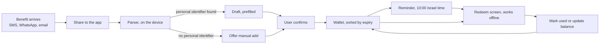

# מסמך דרישות מוצר: שלב 1, גרסת הבודקים

- **עודכן:** 2026-10-23. השחזור עודכן ל־`passkey` עם `PRF` (החלטה 034).
- **מצב:** טיוטה ראשונה.
- **מסמכים קשורים:** [vision.md](vision.md), [product-principles.md](product-principles.md), [domain-model.md](domain-model.md), [decision-log.md](decision-log.md).

לכל דרישה יש מזהה בסוגריים, כדי שבדיקות, משימות ו־`ADR` יוכלו להפנות אליה.

## המטרה

להעביר את הליבה לידי 2 עד 3 בודקים, ולהשתמש בה בעצמנו, כדי לענות על שתי שאלות (החלטה 026):
- **האם אנשים מוסיפים את ההטבות שלהם, וממשיכים להוסיף?** זה הסיכון הגדול.
- **האם תזכורות מובילות לשימוש בהטבות?**

## הלולאה המרכזית

## ההיקף

**בגרסת הבודקים (החלטה 025):**
- התחברות, שחזור אוטומטי, נעילת אפליקציה ומחיקת חשבון.
- הוספה בשיתוף של הודעה, והקלדה ידנית.
- `parser` לתבניות שכבר ראינו.
- ארנק, מסך מימוש ועדכון יתרה.
- תזכורות.
- גיבוי מוצפן, שחזור וייצוא.
- עברית ואנגלית.
- `backoffice` מינימלי: נתונים מצרפיים ובריאות המערכת (החלטה 027).
- הדרישות של `Google Play`.

**אחרי הגל הראשון (החלטה 025):**
- צילום כרטיס פיזי וזיהוי טקסט (`OCR`).
- מתכונים לבירור יתרה.
- הסיכום החודשי.
- שיתוף כטקסט.

**מחוץ לשלב 1:**
- `sync` בין כמה מכשירים (החלטה 009).
- שיתוף מוצפן בתוך האפליקציה, וארנק משפחתי (החלטה 021).
- ייצוא ל־`Google Wallet` (החלטה 019).
- התחברות בקוד חד־פעמי במייל, ו־`iOS` (החלטות 004 ו־012).
- ייבוא בעזרת `AI`.
- חיפוש.
- מודל הכנסה.

## דרישות פונקציונליות

### כניסה וחשבון

- **התחברות:** בלחיצה אחת, עם חשבון `Google` (`AUTH-1`).
- **גיבוי אוטומטי של מפתח הכספת** (`AUTH-2`):
  - בהגדרה הראשונה נוצר `passkey` במנהל הסיסמאות של `Google`, והמשתמש מאשר בטביעת אצבע או בנעילת המסך. אין מה לזכור או לשמור (החלטה 034).
  - אם אי אפשר ליצור `passkey`, למשל כי אין חשבון `Google` מחובר או נעילת מסך, מוצג באנר "הגיבוי שלך לא מוגן", עם הסבר מה לעשות.
- **שחזור במכשיר חדש** (`AUTH-3`):
  - בטלפון שמחובר לאותו חשבון `Google`, אחרי התחברות ואישור ה־`passkey`, כל הפריטים חוזרים, כולל הקודים.
  - אין צורך לשחזר את כל הטלפון מגיבוי, והמשתמש לא צריך להקליד שום דבר.
  - אם הטלפון הישן בהישג יד, אפשר גם לאשר ממנו עם קוד `QR`.
- **`passkey` לא נמצא** (`AUTH-4`):
  - מוצגת הודעה ברורה, ושום מידע לא נפתח.
  - אפשר לאשר מטלפון ישן עם קוד `QR`, או להתחיל ארנק חדש.
  - בשלב 1 אין מפתח שחזור ידני ואין עטיפה שנייה (החלטה 035).
- **הגנה על ה־`passkey`** (`AUTH-8`, החלטה 035):
  - ה־`passkey` נקרא "Coupon Wallet, מפתח הארנק. לא למחוק", ובהגדרה מוצג משפט שמסביר שמחיקה פירושה אובדן כל המידע.
  - האפליקציה בודקת בלי מסך שה־`passkey` קיים. אם הוא נמחק ומפתח הכספת עדיין בטלפון, היא מציעה לתקן, ויוצרת `passkey` חדש אחרי טביעת אצבע.
- **נעילת האפליקציה ברמת הממשק** (`AUTH-5`):
  - בביומטריה או בקוד הנעילה של המכשיר.
  - אם במכשיר אין נעילה בקוד, האפליקציה מבקשת קוד אפליקציה של 4 ספרות.
  - אחרי ניסיונות שגויים, ההמתנה בין ניסיון לניסיון מתארכת. המידע לעולם לא נמחק.
  - קוד שנשכח מאפסים דרך התחברות מחדש עם `Google` (החלטה 028).
- **מחיקת חשבון** (`AUTH-6`):
  - **מתוך האפליקציה:** מיידית, בתנאי שהמכשיר מוכיח שהוא מחזיק את הכספת.
  - **מקישור ב־`web`:** נכנסת לתוקף אחרי 7 ימים. בזמן הזה נשלחת התראת אבטחה למכשיר הפעיל, ואפשר לבטל את המחיקה.
  - **מה נמחק:** המידע בשרת, והמידע שבמכשיר.
- **מעבר למכשיר פעיל חדש:** מותר רק למכשיר שמוכיח שהוא מחזיק את הכספת. במעבר נשלחת התראת אבטחה למכשיר הקודם (`AUTH-7`).

### הוספה

- **שיתוף:** אפשר לשתף הודעה לאפליקציה מכל אפליקציה, למשל מאפליקציית ההודעות, מ־`WhatsApp` או מהמייל. התוצאה היא טיוטה עם שדות ממולאים (`ADD-1`).
- **הפענוח קורה במכשיר.** טקסט ההודעה לא יוצא ממנו (`ADD-2`).
- **תבניות מוכרות:** ה־`parser` מזהה את התבניות שכבר ראינו (`ADD-3`):
  - הודעות הטבה מהמעסיק.
  - `BuyMe`.
  - קופון ממועדון לקוחות.
- **הודעה בתבנית לא מוכרת:** ה־`parser` מנסה לחלץ קוד, תאריכים, סכומים ואחוזים. מה שלא זוהה נשאר ריק (`ADD-4`).
- **אין מזהה אישי:** אם לא נמצא קוד ולא כתוב שההטבה נטענה לחשבון מועדון, מוצגת ההודעה "נראה כמו מבצע פומבי", ומוצעת הוספה ידנית (`ADD-5`).
- **שדה לא חד־משמעי,** כמו שעה לא ברורה בתוקף: הפריט נשאר טיוטה, והשדה מסומן לאישור (`ADD-6`).
- **הקלדה ידנית:** שדות החובה הם בית עסק, סוג ערך וסכום. כל השאר אופציונלי (`ADD-7`).
- **כפילות:** אם קיים כבר פריט עם אותו קוד ואותו בית עסק, מוצגת אזהרה. הבדיקה נעשית במכשיר, כי השרת לא רואה קודים (`ADD-8`).
- **הודעות שהועברו ב־`WhatsApp`:** ה־`parser` מסנן את התאריך ואת שם השולח שבתחילת ההודעה, ואת התצוגה המקדימה של קישורים (`ADD-9`).

### הארנק

- **סדר:** הפריטים ממוינים לפי מועד הפקיעה. פריטים בלי תוקף מופיעים בסוף (`WAL-1`).
- **מצבים שמחושבים ומוצגים:** עוד לא בתוקף, פג בקרוב, פג, נוצל חלקית ויתרה לא ידועה (`WAL-2`).
- **סיכום בראש המסך** (`WAL-3`):
  - הסכום הצבור. נספר רק ערך צבור, לא הנחות.
  - מספר ההטבות שפגות השבוע, בנפרד.
- **פריטים שפגו:** מוצגים באזור נפרד, ואפשר להעביר אותם לארכיון (`WAL-4`).

### מימוש

- **מסך המימוש עובד בלי חיבור לרשת** (`RED-1`).
- **הצגת הקוד** (`RED-2`):
  - הקוד מוצג גדול, ומחולק לקבוצות.
  - הגופן מבדיל בין תווים דומים.
  - יש כפתור העתקה.
- **ברקוד:** מוצג רק אם ידועים התוכן שלו והפורמט שלו, בדיוק כפי שהונפק. אם ידועות רק הספרות, מוצגות רק הספרות (`RED-3`).
- **קישור של המנפיק:** כפתור "פתח אצל המנפיק". כשהמשתמש חוזר לאפליקציה, היא שואלת אם השתמש בהטבה ובכמה (`RED-4`).
- **אחרי שימוש:** "סמן כמנוצל" או "עדכן יתרה". אחרי עדכון, `lastVerifiedAt` מתעדכן (`RED-5`).
- **פריט שלא ניתן להעברה:** ההגבלה של המנפיק מוצגת לצד הקוד (`RED-6`).
- **מסכים שמציגים סודות מוסתרים בתצוגת האפליקציות האחרונות.** המשתמש עדיין יכול לצלם מסך ביוזמתו (`RED-7`).

### תזכורות

- **הכללים:** תזכורות לפי החלטה 017 (`REM-1`):
  - מועדים לפי משך התוקף.
  - איחוד: מותר להקדים עד פי שניים, ואסור לאחר.
  - שליחה ב־10:00 בשעון ישראל.
  - לכל היותר הודעה אחת ביום.
- **ערוצי התראות נפרדים:** לתזכורות ולאבטחה (`REM-2`).
- **ההודעה שעוברת ב־`FCM` לא כוללת שום פרט על הפריטים** (`REM-3`):
  - האפליקציה בונה את הטקסט בעצמה, מהמידע שכבר שמור בה.
  - אם בניסוי יתברר שזה לא אמין, ההודעה תהיה טקסט כללי.
  - אפשר להסתיר סכומים במסך הנעילה.
- **תזכורות שהוחמצו:** אם הסריקה היומית לא רצה, הסריקה הבאה משלימה כל תזכורת שהמועד שלה עבר, כל עוד הפריט בתוקף (`REM-6`).
- **שליטה בתזכורות:** אפשר לכבות תזכורות לפריט מסוים, ויש מתג כללי להשתקה בשבת ובחג (`REM-4`).
- **פריט שסומן כמנוצל או שנמחק לא מקבל עוד תזכורות** (`REM-5`).

### גיבוי וייצוא

- **גיבוי:** כל שינוי נשלח לשרת כ־`metadata` ומידע מוצפן (`BAK-1`).
- **בלי חיבור לרשת:** שינויים נשמרים בתור, ונשלחים כשהחיבור חוזר (`BAK-2`).
- **ייצוא:** ייצוא מלא לקובץ `JSON` לא מוצפן, עם אזהרה שהוא כולל קודים (`BAK-3`). הגיבוי המוצפן הוא השרת.

### שפה ונגישות

- **עברית ואנגלית:** תמיכה מלאה, כולל `RTL` ו־`LTR` (`I18N-1`).
- **פורמטים:** תאריכים בפורמט ישראלי, וסכומים עם ₪ (`I18N-2`).
- **נגישות:** הגדלת גופן, ניגודיות מספקת, ותוויות לקורא מסך (`A11Y-1`).

### `backoffice` מינימלי

- **מה רואים:**
  - מדדי ההצלחה, כנתונים מצרפיים בלבד (`OPS-1`).
  - בריאות המערכת: שגיאות ב־`API`, הצלחה של הסריקה היומית וכשלים במשלוח התראות (`OPS-2`).
- **מה לא רואים:** נתונים של משתמש מסוים. קודים ממילא בלתי אפשריים לצפייה (`OPS-3`).
- **גישה** (`OPS-4`, החלטה 031):
  - דף ניהול שנפתח מתוך האפליקציה, רק למשתמש שהשרת מזהה כמפעיל.
  - לפני הפתיחה נדרש אימות ביומטרי, וכל כניסה נרשמת.
- **הסכמה של הבודקים:** כשיש מעט משתמשים, גם נתונים מצרפיים מזהים אנשים. לכן הבודקים מסכימים מראש שהמפעיל רואה נתוני פעילות שלהם, לעולם לא קודים (`OPS-5`).

### דרישות של `Google Play`

- **מסמכים:** מדיניות פרטיות, וטופס `Data safety` (`STORE-1`).
- **מחיקת חשבון:** מתוך האפליקציה ומקישור ב־`web` (`AUTH-6`).
- **בדיקה פנימית:** הבודקים מקבלים את האפליקציה דרך מסלול הבדיקה הפנימית של `Google Play` (`STORE-2`).
- **פרסום ציבורי בעתיד:** לפי מה שזכור לי, חשבון מפתח חדש צריך לפני פרסום ציבורי לפחות 12 בודקים במשך 14 יום (לאימות). עם 2 עד 3 בודקים זה חסם עתידי, ולא חלק משלב 1.

## דרישות לא־פונקציונליות

- **אבטחה:**
  - הסודות מוצפנים במכשיר, וכל `ciphertext` נושא מספר גרסה (החלטות 003 ו־008) (`SEC-1`).
  - שום קוד או טקסט חופשי לא מופיע בלוגים, באנליטיקה או בדוחות קריסה (`SEC-2`).
  - **בדיקה ל־`SEC-2`:** בדוגמאות הבדיקה יש קודים "מלכודת", ו־`CI` נכשל אם אחד מהם מופיע בפלט כלשהו.
- **אנליטיקה:** אירועים כוללים רק סוגים ומספרים, לא תוכן (`PRIV-1`).
- **דוחות קריסה:** בלי צילומי מסך ובלי טקסט מהממשק (`SEC-3`).
- **גיבויים של מסד הנתונים:** נשמרים 14 יום בלבד, ולכן מחיקה מושלמת תוך 14 יום. מדיניות הפרטיות אומרת את זה במפורש (`PRIV-2`).
- **עמידות:** כשהשרת לא זמין, האפליקציה ממשיכה לעבוד. רק הגיבוי והתזכורות מתעכבים (`REL-1`).
- **ביצועים:** מסך המימוש נפתח תוך שנייה, גם בלי חיבור לרשת (`PERF-1`).
- **מכשירים:** ‏`Android 14` ומעלה (`DEV-1`, החלטה 037).

## מדדי הצלחה

עם 2 עד 3 בודקים, אחוזים לא אומרים הרבה. לכן המדדים הם תצפיות על כל בודק בנפרד (החלטה 026).

**התצפית הראשית: התמדה בהוספה.**
- **ההגדרה:** האם כל בודק הוסיף לפחות פריט אחד בימים 15 עד 28 מההתקנה.
- **אות אזהרה:** אם רוב הבודקים הפסיקו להוסיף, הפוקוס עובר לשיפור ההוספה. אין סף עצירה.
- **הרף לטווח הארוך:** שהאפליקציה תשמש באופן קבוע לפחות אחד מכל עשרה אנשים שמנסים אותה. אפשר יהיה למדוד את זה רק כשיהיו יותר משתמשים.

**מדדים משניים:**
- **זמן הוספה:** החציון מהשיתוף ועד השמירה. היעד: עד 10 שניות לתבניות מוכרות.
- **ערוץ ההוספה:** כמה פריטים נוספו בשיתוף, וכמה בהקלדה ידנית.
- **מתזכורת לשימוש:** כמה פריטים שקיבלו תזכורת סומנו כמנוצלים או עודכנו לפני שפג התוקף. זה הבסיס לכיול של החלטה 017.
- **הסתייגות במדידה:** משתמשים עלולים לשכוח לסמן פריט כמנוצל. לכן המדדים יגובו בשיחות.

**מדד איכותי:** שיחה קצרה עם כל בודק אחרי 4 שבועות, בשיטת `The Mom Test`.

**תרחישים מדומים:** את המקרים שהבודקים לא יפגשו בודקים בסימולציה.
- כל תרחיש הוא חודש שלם בחייו של משתמש מדומה: הטבות שמגיעות, שימוש, תזכורות ופקיעה.
- התרחישים רצים בבדיקות, עם שעון שמוזרק, תוך שניות.
- הם נבנים מהדוגמאות האמיתיות שבמודל ה־`domain`.

## קריטריונים לשחרור

- **ה־`parser`:**
  - כל דוגמאות הבדיקה עוברות, כשהקודים בהן מוחלפים בקודים מזויפים.
  - הדוגמאות כוללות את שמונה הדוגמאות שלנו, וגם וריאציות עליהן.
- **שחזור:**
  - נבדק על מכשיר פיזי שני שמחובר לאותו חשבון `Google`, בלי הטלפון הראשון.
  - נבדק גם מכשיר שלא יכול ליצור `passkey`, ובו מוצג הבאנר של `AUTH-2`.
- **תזכורות:** כל התרחישים עוברים עם שעון שמוזרק בבדיקה. ביניהם:
  - הדוגמה של שני הקופונים של שופרסל.
  - פריט שסומן כמנוצל.
  - המעבר לשעון חורף בסוף אוקטובר.
  - ריצה חוזרת של הסריקה, בלי הודעה כפולה.
- **בדיקת המלכודת של `SEC-2`** עוברת.
- **מחיקת חשבון** עובדת מקצה לקצה.
- **מימוש במצב טיסה** עובד.

## הגל הראשון של הבודקים

- **הפצה:** בדיקה פנימית ב־`Google Play`, ל־2 עד 3 בודקים. גם המשתמש הראשון משתמש באפליקציה בעצמו.
- **הסכמה:** לפני שמתחילים, כל בודק מסכים לכך שהמפעיל רואה נתוני פעילות שלו (`OPS-5`).
- **ערוץ משוב:** קבוצה אחת. בה גם מבקשים מהבודקים דוגמאות הודעה, עם הקודים מושחרים, כדי להרחיב את ה־`parser`.
- **סיום הגל:** אחרי 4 שבועות.
  - בוחנים את התצפיות, ומקיימים את השיחות.
  - מחליטים: ממשיכים לחלק השני של שלב 1, או משפרים קודם את ההוספה.

## סיכונים ותלויות

- **תמיכה בשיתוף ל־`Expo` ב־`Android`:** דורשת `config plugin` (לאימות). צריך לבדוק את זה בניסוי טכני קטן, לפני שבונים עליו.
- **דיוק ה־`parser`:** הוא מוגבל לתבניות שכבר ראינו. דוגמאות מהבודקים ירחיבו אותו.
- **`passkey` שנמחק או שלא נוצר:** בלי עטיפה שנייה, אובדן ה־`passkey` פירושו אובדן הקודים. לכן הבאנר של `AUTH-2` חייב להיות ברור, ומה שמגן בשלב 1 הוא `AUTH-8` (החלטה 035).
- **דומיין למוצר:** ה־`passkey` קשור לדומיין, ולכן צריך לבחור אותו לפני שהבודקים יוצרים `passkey` (החלטה 034).
- **הדרישות של `Google Play`:** הן עלולות לעכב את ההפצה.

## שאלות פתוחות

- **שם האפליקציה.**
