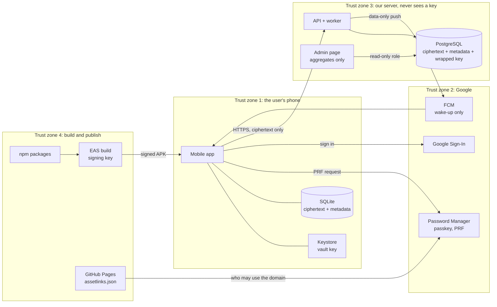

# מודל איומים

- **עודכן:** 2026-10-30.
- **מצב:** גרסה ראשונה, לשלב 1.
- **מסמכים קשורים:** [architecture.md](architecture.md), [ADR-001](adr/ADR-001-key-management.md), [prd.md](prd.md), [decision-log.md](decision-log.md).

## היקף ושיטה

- **היקף:** כל המערכת של שלב 1. האפליקציה, השרת, דף הניהול, השירותים החיצוניים, הבנייה וההפצה.
- **שיטה:** `STRIDE`. לכל רכיב שואלים שש שאלות:
  - **התחזות (`Spoofing`):** האם מישהו יכול להעמיד פנים שהוא מישהו אחר?
  - **שינוי מידע (`Tampering`):** האם מישהו יכול לשנות מידע בלי שנשים לב?
  - **הכחשה (`Repudiation`):** האם מישהו יכול להכחיש פעולה שעשה?
  - **חשיפת מידע (`Information disclosure`):** האם מידע יכול לדלוף?
  - **מניעת שירות (`Denial of service`):** האם מישהו יכול לשבש את השירות?
  - **הסלמת הרשאות (`Elevation of privilege`):** האם מישהו יכול לקבל יותר הרשאות ממה שמגיע לו?
- **מה כל שורה כוללת:** האיום, ההגנה הקיימת עם הפניה להחלטה או לדרישה, והסיכון שנשאר.

## מה מגינים עליו

- **הקודים:** פרטי המימוש וכל הטקסט החופשי. זה הנכס החשוב ביותר, כי קוד שווה כסף.
- **מפתח הכספת:** פותח את כל הקודים.
- **פלט ה־`PRF` של ה־`passkey`:** ממנו נגזר המפתח שעוטף את מפתח הכספת.
- **המפתח העטוף:** שמור בשרת. בלי פלט ה־`PRF` הוא חסר ערך.
- **ה־`metadata`:** בית עסק, סכום ותוקף. זה מידע אישי, אבל אי אפשר לממש אותו.
- **`tokens` של התחברות:** מאפשרים לפעול בשם המשתמש מול השרת.
- **גישת המפעיל:** דף הניהול.
- **הדומיין:** ‏`danielshapi4a.github.io`, שמפרסם את `assetlinks.json`.
- **מפתח החתימה ב־`EAS`:** מוכיח ש־`Android` מריץ את האפליקציה שלנו ולא חיקוי.

## גבולות האמון

**העיקרון:** הקודים גלויים רק באזור 1, ורק בזיכרון של האפליקציה. כל מה שעובר לאזורים 2 ו־3 מוצפן, או שהוא `metadata`.

## התוקפים

- **פורץ לשרת:** משיג את מסד הנתונים ואת הגיבויים.
- **מפעיל זדוני:** אנחנו, או מי שמקבל גישה לדף הניהול.
- **משתלט על חשבון `Google`:** יודע את הסיסמה, או גנב את ה־`session`.
- **גנב של טלפון נעול.**
- **אפליקציה זדונית באותו טלפון.**
- **תוקף ברשת:** למשל `Wi-Fi` ציבורי.
- **חבילת `npm` פרוצה:** קוד זדוני שנכנס לאפליקציה בבנייה.
- **מי שיכול לכתוב לדומיין:** גישה ל־`repo` ‏`danielshapi4a.github.io`.

## ניתוח לפי רכיב

### האפליקציה בטלפון

- **התחזות:** אפליקציה אחרת שמתחזה לשלנו ומבקשת את ה־`passkey`.
  - **הגנה:** ‏`Android` מאפשר את ה־`passkey` רק לאפליקציה שחתומה במפתח שמופיע ב־`assetlinks.json` (החלטה 034).
  - **סיכון שנשאר:** דליפה של מפתח החתימה, ראו "בנייה והפצה".
- **שינוי מידע:** שינוי של מידע מוצפן ב־`SQLite`.
  - **הגנה:** הצפנה מאומתת עם `AAD`, ולכן כל שינוי נכשל בפענוח (`ADR-001`).
- **חשיפת מידע:**
  - קוד שמופיע בתצוגת האפליקציות האחרונות, בלוגים או בדוח קריסה.
    - **הגנה:** `RED-7`, `SEC-2` ו־`SEC-3`. יש בדיקת מלכודת ב־`CI`.
  - טלפון נעול שנגנב.
    - **הגנה:** ההצפנה של `Android`, ומפתח הכספת ב־`Keystore`.
  - טלפון פתוח שנגנב.
    - **הגנה:** נעילת אפליקציה (`AUTH-5`).
    - **סיכון שנשאר:** הנעילה היא ברמת הממשק, ולא ברמת החומרה (החלטה 028). מקבלים את זה.
  - אפליקציה זדונית שקוראת את המסך או את הלוח.
    - **הגנה:** הארגז של `Android`, שמפריד בין אפליקציות.
    - **סיכון שנשאר:** קוד שהועתק ללוח, וטלפון שנפרץ (`root`). מקבלים את זה.
- **מניעת שירות:** מחיקת ה־`passkey`, בטעות או בכוונה.
  - **הגנה:** אזהרה בשם, זיהוי שקט ותיקון עצמי (`AUTH-8`, החלטה 035).
  - **סיכון שנשאר:** ‏`passkey` שנמחק יחד עם טלפון שאבד. מקבלים את זה בשלב 1.

### השרת: `API`, ה־`worker` ו־`PostgreSQL`

- **התחזות:** שימוש ב־`token` שנגנב.
  - **הגנה:** ‏`access token` קצר מועד, ו־`refresh token` מתחלף (החלטה 012).
  - **סיכון שנשאר:** בזמן החיים הקצר של ה־`token` אפשר לקרוא `metadata` ומידע מוצפן. קודים אי אפשר לקרוא.
- **שינוי מידע:** שרת פרוץ שמעביר קוד מוצפן מפריט לפריט.
  - **הגנה:** ‏`AAD` עם מזהה הפריט (`ADR-001`).
  - **שרת פרוץ שמחליף את המפתח העטוף:** הפענוח ייכשל, כלומר זו מניעת שירות ולא חשיפה.
- **הכחשה:** משתמש שטוען שלא מחק את החשבון.
  - **הגנה:** מחיקה מתוך האפליקציה דורשת חתימה של המכשיר. מחיקה מה־`web` מחכה 7 ימים, ונשלחת עליה התראה (`AUTH-6`, החלטה 033).
- **חשיפת מידע:** פריצה למסד הנתונים.
  - **הגנה:** השרת לא מחזיק אף מפתח. הקודים חסרי ערך בלי ה־`passkey` (החלטות 003 ו־034). גיבויים נשמרים 14 יום (`PRIV-2`).
  - **סיכון שנשאר:** ה־`metadata` נחשף. מקבלים את זה (החלטה 006).
- **מניעת שירות:** עומס, או סריקה יומית שנכשלה.
  - **הגנה:** `rate limiting`, והשלמה של תזכורות שהוחמצו (`REM-6`).
  - **סיכון שנשאר:** השרת לא זמין. המימוש ממשיך לעבוד בלי רשת (החלטה 007).
- **הסלמת הרשאות:** משתמש שכותב לפריטים של משתמש אחר.
  - **הגנה:** כל בקשה נבדקת מול בעלי הפריט. המכשיר הפעיל מוגן ב־`fencing` עם חתימה (`AUTH-7`).
  - **לבדיקות:** בדיקת אבטחה שמנסה לגשת לפריט של משתמש אחר.

### השתלטות על חשבון `Google`

- **מה התוקף משיג:** התחברות לשרת, ולכן גם את ה־`metadata` ואת המידע המוצפן.
- **מה התוקף לא משיג:** את הקודים. כדי להשתמש ב־`passkey` בטלפון חדש צריך גם את קוד הנעילה של טלפון ישן, או את ה־`PIN` של מנהל הסיסמאות (לאימות).
- **מה התוקף יכול להרוס:**
  - למחוק את ה־`passkey`. מגן עליו התיקון העצמי, כל עוד הטלפון של המשתמש אצלו.
  - לבקש מחיקה מה־`web`. מגנים עליה 7 ימי ההמתנה וההתראה.
  - להפוך למכשיר הפעיל. אי אפשר, כי זה דורש חתימה של מפתח הכספת (`AUTH-7`).
- **סיכון שנשאר:** תוקף שגם יודע את קוד הנעילה. מקבלים את זה.

### דף הניהול

- **התחזות והסלמת הרשאות:** משתמש רגיל שפותח את הדף.
  - **הגנה:** ההרשאה נבדקת בשרת, נדרש אימות ביומטרי, וכל כניסה נרשמת (החלטה 031).
- **חשיפת מידע:** מפעיל שמסתכל על נתונים של משתמש מסוים.
  - **הגנה:** הדף מציג נתונים מצרפיים בלבד, ומשתמש מסד הנתונים שלו מוגבל לקריאה (החלטה 027).
  - **סיכון שנשאר:** עם 2 עד 3 בודקים, גם נתון מצרפי מזהה אנשים. הבודקים מסכימים לזה מראש (`OPS-5`).

### התראות `FCM`

- **חשיפת מידע:** ‏`Google` קורא את תוכן ההתראה.
  - **הגנה:** ההודעה בלי תוכן. האפליקציה בונה את הטקסט (`REM-3`).
- **התחזות:** התראה מזויפת.
  - **הגנה:** ההודעה רק מעירה את האפליקציה. כל מה שמוצג מגיע מהמידע המקומי.

### הרשת

- **חשיפה ושינוי בדרך:** התקפת `man-in-the-middle`.
  - **הגנה:** ‏`HTTPS` בלבד. גם אם ההצפנה בדרך נשברת, הקודים עדיין מוצפנים.
  - **לאימות בהמשך:** האם להצמיד את התעודה של השרת (`certificate pinning`). בשלב 1 לא.

### בנייה והפצה

- **חבילת `npm` פרוצה:** הסיכון הקשה ביותר בשלב 1, כי קוד זדוני רץ בתוך האפליקציה ורואה את הקודים.
  - **הגנה:**
    - `package-lock.json`, כך שכל בנייה מתקינה בדיוק את אותן גרסאות.
    - `npm 12` חוסם סקריפטי התקנה, וכל סקריפט מאושר במפורש (`allowScripts`).
    - מעט תלויות.
  - **סיכון שנשאר:** קוד זדוני בספרייה שאנחנו כבר סומכים עליה. מקבלים את זה, ובודקים כל ספרייה לפני שמוסיפים אותה.
- **מפתח החתימה ב־`EAS`:**
  - **סיכון:** מי שמשיג אותו יכול לבנות אפליקציה שמקבלת גישה ל־`passkey`.
  - **הגנה:** המפתח שמור אצל `EAS`, והחשבון מוגן באימות דו־שלבי (לאימות שהופעל).
- **הדומיין, `danielshapi4a.github.io`:**
  - **סיכון:** מי שכותב ל־`repo` יכול להוסיף לקובץ `assetlinks.json` אפליקציה שלו.
  - **הגנה:** אימות דו־שלבי לחשבון `GitHub` (לאימות שהופעל). מעבר לדומיין משלנו לפני הבודק הראשון (החלטה 036).

## העמקה: מפתחות ושחזור

התרחישים מהניסוי הטכני 01, ומה קורה בכל אחד מהם:
- **התקנה מחדש באותו טלפון:** ה־`passkey` נשאר, והארנק חוזר (עובדה, נבדק).
- **טלפון חדש, אותו חשבון `Google`:** הארנק חוזר (עובדה, נבדק).
- **אישור עם `QR` מטלפון אחר:** הארנק חוזר (עובדה, נבדק).
- **ה־`passkey` נמחק, והטלפון אצל המשתמש:** תיקון עצמי (החלטה 035).
- **ה־`passkey` נמחק, והטלפון אבד:** הארנק אבוד. סיכון שמקבלים.
- **מעבר לחשבון `Google` אחר:** לא מכוסה. סיכון שמקבלים, ועדיין לא נבדק.
- **טלפון בלי נעילת מסך או בלי חשבון `Google`:** אי אפשר ליצור `passkey`. מוצג באנר (`AUTH-2`).

## סיכונים שמקבלים בשלב 1

- ‏`passkey` שנמחק יחד עם טלפון שאבד.
- מעבר לחשבון `Google` אחר.
- ה־`metadata` נחשף בפריצה לשרת.
- נעילה ברמת הממשק בלבד.
- קוד זדוני בספרייה שכבר סומכים עליה.
- אין `certificate pinning`.

## לאימות

- **`prepareGetCredential`:** האם הוא מזהה בלי מסך ש־`passkey` נמחק, ואם `react-native-passkeys` חושף אותו.
- **טלפון חדש:** איזה אימות נוסף `Google` דורש לפני שאפשר להשתמש ב־`passkey`.
- **מעבר לחשבון `Google` אחר:** מה קורה בפועל.
- **אימות דו־שלבי:** שהוא מופעל ב־`GitHub` וב־`Expo`.
